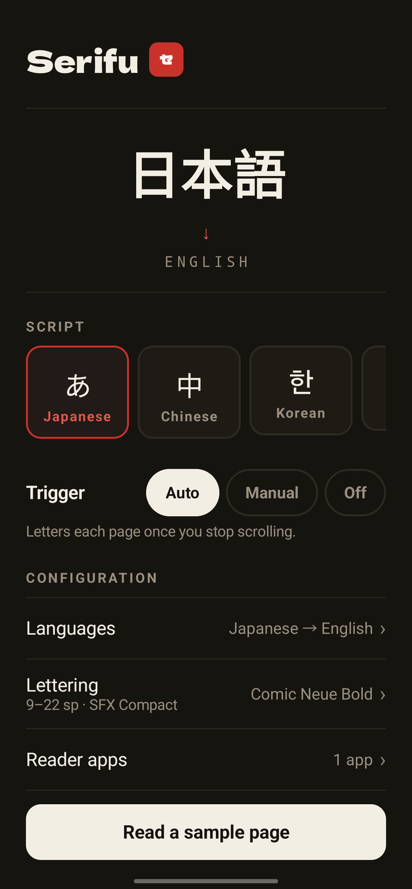
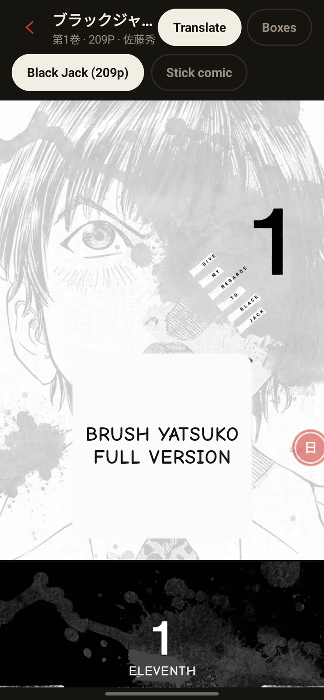
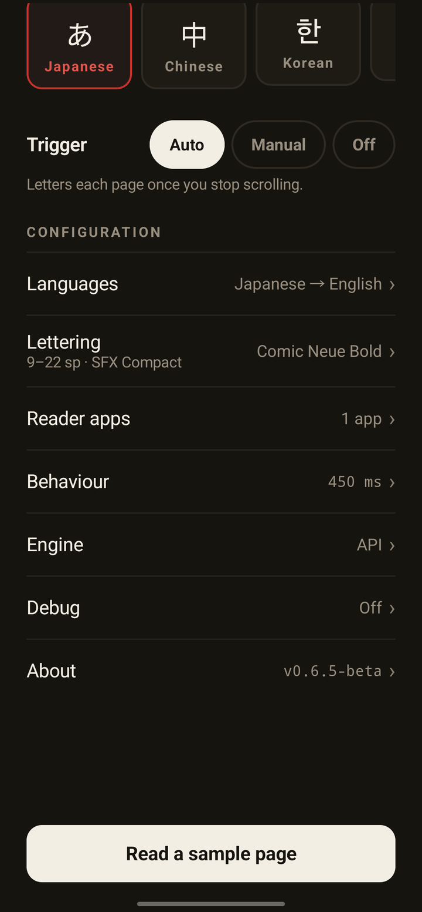
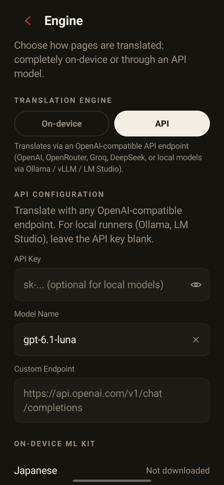
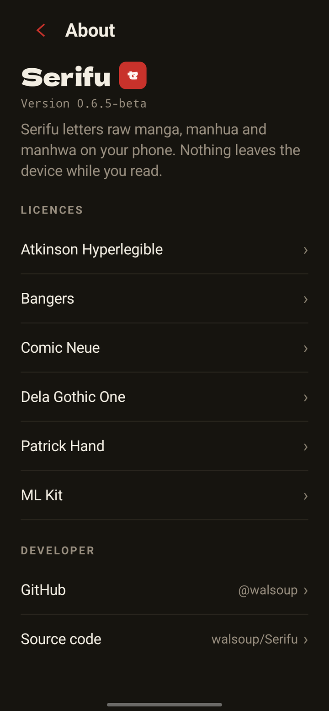
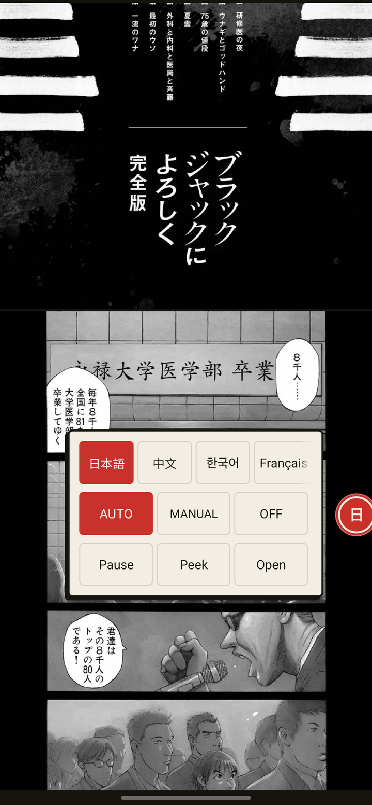
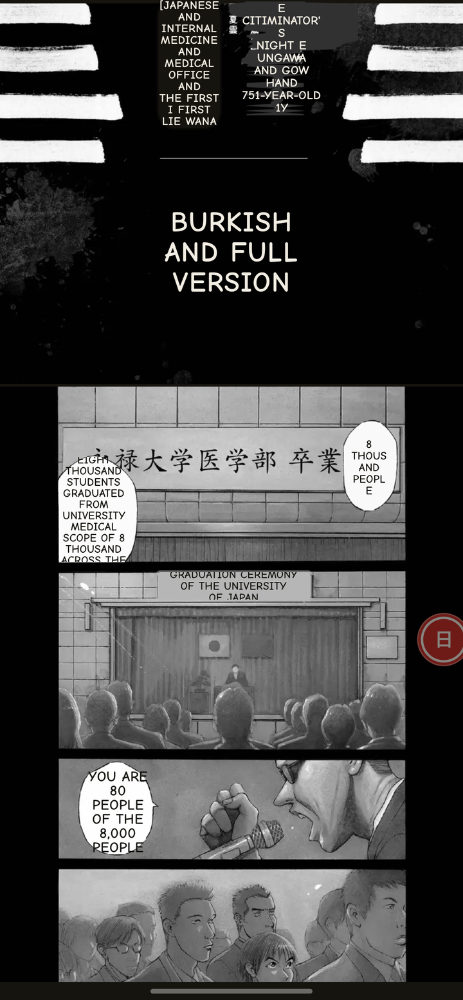

<p align="center">
  
</p>

# Serifu

Serifu translates manga, manhua, and manhwa on an Android phone. It screenshots a reader you choose, finds the bubbles, and draws English over them.

- Japanese, Chinese, and Korean, plus Latin-script sources (English, French, Spanish, German, Italian, Portuguese)
- On-device translation with ML Kit, or an optional OpenAI-compatible cloud backend
- One-time language pack download of about 30 MB

This tree is version 0.6.6-beta, with `applicationId` `app.walsoup.serifu` and `minSdk` 30.

## Pages

Home picks the source script and the trigger:

- **Auto** translates after the page stops moving.
- **Manual** waits for a tap on the pill.
- **Off** draws nothing.



The sample page bundles:

- The full Volume 1 of *Give My Regards to Black Jack* (ブラックジャックによろしく) by SHUHO SATO (佐藤秀峰) - 209 pages, shared by the author under free secondary-use terms (二次利用フリー) for vertical-scroll reading and live lettering
- A multi-language stick-figure comic test page

**Translate** runs OCR, clustering, translation, and lettering. **Boxes** draws the regions the clusterer found. Tap the page to hide the toolbar.



The rest of the settings sit on the home screen, under the trigger.



| Row | What it sets |
| --- | --- |
| Languages | Source script, the language you read, and the offline packs |
| Lettering | Font, size range, sound effects (compact, cover, or off). A fresh install uses 9-22 sp. |
| Reader apps | Packages Serifu is allowed to screenshot |
| Behaviour | How long Auto waits after the last scroll (default 450 ms), plus honorifics and the pill |
| Engine | On-device ML Kit or an OpenAI-compatible API endpoint (Fast, Progressive, Best only) |
| Debug | Region outlines and the reasoning level sent to the API engine |
| About | Version and the OFL font licences |





## First launch

Four steps:

1. Pick the source script.
2. Grant the restricted settings Android requires for a sideloaded accessibility app.
3. Enable the accessibility service.
4. Choose the reader apps.

The service is what takes the screenshot. While it is off, the bottom button opens accessibility settings. With it on, the button is Read a sample page, unless the trigger is Off, in which case it turns Serifu back to Auto.

Over a chosen reader, a tactile pill sits on the screen edge. A tap translates the current page, while a double-tap opens the floating HUD to swap languages on the fly, adjust trigger modes, or pause translation.

<p align="center">
  
  &nbsp;&nbsp;
  
</p>

## How it works

Three Gradle modules:

- `:core` - plain Kotlin, no Android imports.
- `:app` - the phone.
- `:linen` - the design system the screens are built on.

Serifu paints with its own palette: paper `#F3EEE3`, ink `#16140F`, hanko `#C8322B`.

### TranslationEngine (`:core`)

The translator boundary.

- `availability(source, target)` returns `Ready`, `NeedsDownload`, `Downloading`, or `Unsupported`.
- `translatePage` takes a `PageTranslationRequest` (source language, target tag, one `BubbleText` per bubble, the previous page's lines, and whether to keep honorifics) and returns a `PageTranslationResult`, a map of bubble id to English.
- `EngineId` is `MLKIT`, `GEMMA4_E2B`, or `AI_REMOTE`.

On-device translation is `MlKitTranslationEngine`. The cloud backend is `RemoteAiTranslationEngine` in `:app`: it posts the page's bubbles to the configured endpoint and caches the replies. `GEMMA4_E2B` is a cache-key value. `PromptBuilder` and `LlmResponseParser` turn bubbles into a prompt and read a reply back, and both have tests beside the other `:core` tests.

### Page flow (`:app`)

`PagePipeline` is the page path: vertical retiling, `SpeechBubbleClusterer`, ML Kit, then `LetteringRenderer`. The accessibility service and the sample page both call it.

The reading loop is `Reducer.reduce(state, event, now, config)`. It returns a `Transition`: the next `CoordinatorState` plus a list of `Effect`s (`Capture`, `Process`, `ShowPage`, `ScheduleSettle`, show or hide the pill, and the rest). Screenshot and translation are effects, run by `EventRouter`, which turns accessibility callbacks into those events.

Shared vision types:

- `OcrLine` is one recognized line: text, box, confidence, angle, and per-glyph boxes.
- `SpeechBubbleCluster` groups the lines of one balloon. `letteringRect` is the box the English has to fit. `patchRect` is what gets painted over. `kind` is a `BubbleKind`: `DIALOGUE`, `CAPTION`, `SFX`, or `FREE_TEXT`.

`SerifuAccessibilityService` takes the screenshot. `OverlayManager` draws the lettering and the pill.

## Tests

JVM, no device:

```
./gradlew :core:test :app:testDebugUnitTest
```

`:core:test`

- Bubbles and ink: `BubbleRegionEstimatorTest`, `SpeechBubbleClustererTest`, `BubbleCleanTest`, `BubbleSpanTest`, `LineFilterTest`, `ColorSamplerTest`, `InkWallDetectorTest`, `FuriganaFilterTest`.
- Lettering fit: `BalloonBreakTest`, `TextFitSearchTest`.
- Translation: `TranslationCacheTest`, `PromptBuilderTest`, `LlmResponseParserTest`.
- The reading loop and capture: `ReducerTest`, `PageCacheTest`, `ScrollEstimatorTest`, `FrameFingerprintTest`, `CaptureRetryTest`, `SelfDetectionTest`.
- Smaller checks: `LumaMathTest`, `GeometryTest`, `OrientationTest`, `TextNormalizerTest`, `TuningTest`.

`:app:testDebugUnitTest` is `LetteringRendererTest` (the patch stays inside the bubble), `RemoteAiTranslationEngineTest`, `EventRouterTest`, and `SettingsCodecTest`.

On a device:

```
./gradlew :app:connectedDebugAndroidTest
```

`PipelineOnTestPageTest` opens the sample page, copies the window, and expects the line プラスチック plus lettering in the bubbles. `SvgPanelPairTest` draws two panels from SVG and checks each bubble comes back with a translation.

## Build

The debug build needs JDK 17. `./gradlew :app:assembleDebug` writes the debug APK.

## Licenses

Serifu's own code is source-available under the PolyForm Noncommercial License 1.0.0 (see LICENSE): reading, modifying and sharing for non-commercial purposes is fine, while commercial use needs permission. It is not an open-source license.

- `linen/` is the Linen design system, all rights reserved (see `linen/LICENSE`).
- The lettering fonts are under the SIL Open Font License (see `app/src/main/assets/licenses/`).
- The bundled sample manga is *Give My Regards to Black Jack* (ブラックジャックによろしく) by SHUHO SATO (佐藤秀峰), used under the author's secondary-use terms (<https://densho810.com/free/>), not under the app's license.

## Status

Serifu is a beta. The pipeline is covered by JVM unit tests, but it has not been validated on real devices yet, so OCR and lettering may still change. Feedback and bug reports are welcome.
