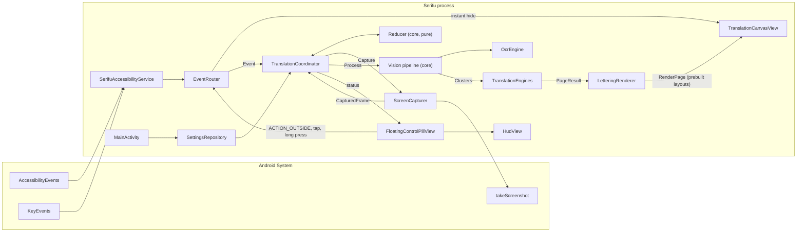
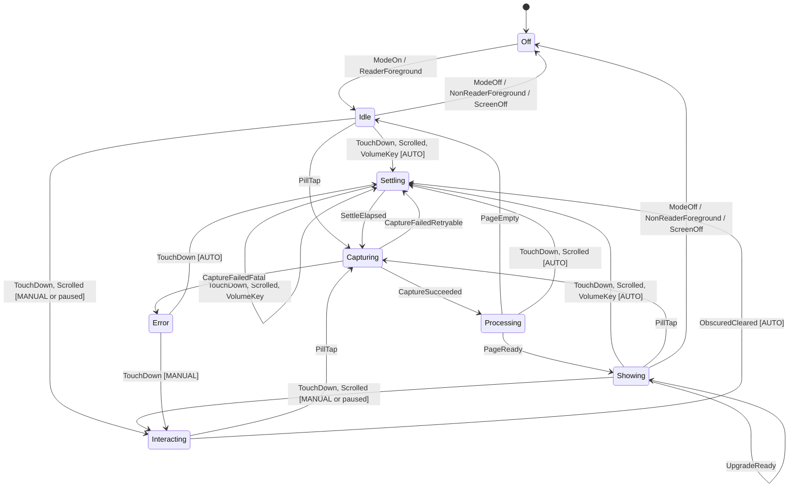

# Serifu — Build Specification

> **Serifu** (セリフ, *serifu*: the spoken lines inside a manga panel) is a 100% on-device Android screen translator for raw Japanese manga, Chinese manhua and Korean manhwa. It works on top of any reader app (Mihon, Kotatsu, Tachiyomi forks, browsers) and draws translated lettering directly over the original speech bubbles.

This document is the single source of truth for the build. It supersedes `proj.txt` (kept as the original brief). An implementing agent must be able to build the entire app from this file alone. Where this document and `proj.txt` disagree, this document wins; section 2 explains every change.

**Rules for the implementing agent**

1. No placeholders, `TODO` stubs, mock logic or "left as an exercise". Every file listed in section 16 is implemented completely.
2. Verify every dependency version against Google Maven / Maven Central at build time. The versions in section 3 were verified in October 2026; bump patch versions if newer ones exist, never downgrade.
3. Every number in this document (thresholds, timings, sizes) is a named constant in code (`object Tuning`), never an inline literal, so tuning never requires hunting through files.
4. Work milestone by milestone (section 17). Each milestone ends with `./gradlew assembleDebug testDebugUnitTest lintDebug` passing.
5. When the spec says "MUST", it is an acceptance criterion. "SHOULD" is a strong default the agent may deviate from only with a code comment stating the constraint that forced it.

---

## Table of contents

1. Product brief
2. Review of `proj.txt`: what changed and why
3. Tech stack and versions
4. Architecture
5. Accessibility service configuration
6. Overlay windows
7. Coordinator state machine
8. Screen capture
9. Change detection and scroll-shift reuse
10. Vision engine: lines, clusters, bubbles
11. Translation engines
12. Lettering renderer
13. Companion app (Compose)
14. Art direction: "Ink and Paper"
15. Performance budgets and edge cases
16. Project structure and deliverables
17. Milestones, acceptance criteria and test plan

---

## 1. Product brief

### 1.1 The core reading loop

1. The user opens a raw chapter in their reader app. Serifu's **pill** sits half-tucked on the screen edge.
2. The user stops scrolling. About 450 ms later, translated English lettering appears over every speech bubble, matching the bubble's paper colour so it looks like a scanlation.
3. The user touches the screen to scroll or turn the page. The lettering vanishes **in the same frame**, so the raw art moves without ghosting.
4. When the page settles again, Serifu either reuses the cached translation (same page, or the same page scrolled a little) or translates the new content.

Every design decision in this document serves that loop: **instant hide, fast settle, never wrong positions, lettering that looks like it belongs on the page.**

### 1.2 Goals

- Fully offline after the one-time model downloads. No accounts, no API keys, no telemetry, no network calls during reading.
- Works with any reader app without integration; the user picks which apps Serifu is active in.
- Japanese vertical text (tategaki), Japanese/Chinese horizontal text, Korean horizontal text.
- Target languages: English by default; any ML Kit Translate language as an option.
- Two translation quality tiers: fast (ML Kit) and high quality (on-device Gemma 4 LLM), with progressive upgrade.

### 1.3 Non-goals (v1)

- Inpainting / erasing original glyphs from the art (we cover them with matched patches instead).
- Cloud translation of any kind.
- Translating video, games or arbitrary apps (it may work, but we neither tune nor test for it).
- Google Play distribution (see 1.4).
- Tablets / foldables in multi-window layouts beyond "does not crash, translates the full display".

### 1.4 Distribution

Serifu ships as a **sideloaded APK** (GitHub Releases, optionally F-Droid). Consequences:

- Google Play's AccessibilityService policy does not apply, but we still declare `android:isAccessibilityTool="false"` and show an honest disclosure screen.
- On Android 13+ the system blocks enabling accessibility services for sideloaded apps until the user taps **App info → ⋮ → Allow restricted settings**. The onboarding (section 13.2) MUST walk the user through this with screenshots-as-illustrations and deep links.
- Release builds are signed with a stable release key and minified with R8 (ML Kit ships its own consumer ProGuard rules; LiteRT-LM keep rules are added in `proguard-rules.pro` if the library's consumer rules are missing).

### 1.5 Target readers (test matrix)

| App | Package | Layouts to test |
| --- | --- | --- |
| Mihon | `app.mihon` | Paged R-to-L, paged L-to-R, vertical/webtoon, continuous vertical |
| Kotatsu | `org.koitharu.kotatsu` | Paged, webtoon |
| Tachiyomi forks (TachiyomiSY, J2K) | `eu.kanade.tachiyomi.sy`, `eu.kanade.tachiyomi.j2k` | Paged, webtoon |
| Chrome | `com.android.chrome` | Long-strip manhwa sites, zoomed pages |
| Firefox | `org.mozilla.firefox` | Same as Chrome |

The first-run app picker pre-selects whichever of these are installed.

---

## 2. Review of `proj.txt`: what changed and why

The original brief has the right architecture (a touch-through overlay, a debounce driven by touches and scroll events, and grouping OCR lines into bubbles before translating). The following issues would have produced bugs or unbuildable code if followed literally.

| # | Issue in `proj.txt` | Consequence | Fix in this spec |
| --- | --- | --- | --- |
| 1 | One 64-bit dHash of a 9×8 thumbnail of the whole screen decides whether to reuse cached bubbles (Hamming ≤ 3). | A 30–80 px webtoon scroll often changes ≤ 3 bits, so cached bubbles are redrawn **at their old positions**. The status-bar clock also changes the hash every minute. | 32×32 luma fingerprint with status/navigation bars masked, plus a row-profile cross-correlation that estimates the vertical scroll offset and **shifts** cached bubbles (section 9). |
| 2 | `ACTION_OUTSIDE` is treated as a general touch sensor. | It fires only on the finger-down of a gesture, never on finger-up, and its coordinates are zeroed for windows of other apps. Volume-key page turns produce no touch at all. | Touch-down only hides and arms the settle timer; scroll events extend it; a non-consuming `onKeyEvent` handles volume keys (sections 5, 7). |
| 3 | Subscribes to `typeWindowContentChanged` without defining behaviour. | Fires constantly (progress bars, clocks, image loading); naive handling hides the overlay over and over. | Content-changed events never hide the overlay. They are used only to retry a capture that found no text (images still loading) (section 5.3). |
| 4 | Waits one `Choreographer` frame after hiding the overlay before capturing. | One app-side frame does not guarantee the compositor has dropped our layer; the screenshot can contain our own English text, which is then "translated". | Hide → `registerFrameCommitCallback` → one more vsync → capture; plus a self-detection check on the captured frame (section 8.3). |
| 5 | The bubble-border ("ink wall") check samples 7 pixels. | Steps right over a 2 px border; two adjacent bubbles get merged into one sentence. | Dense sampling along 3 parallel rays looking for a background → ink → background pattern (section 10.5). |
| 6 | Pixel thresholds are fixed (`< 14px` noise). | Behaves differently on 720p vs 1440p screens. | All geometry thresholds scale with `refUnit = screenWidthPx / 1080f` (section 10.1). |
| 7 | Furigana is not handled. | Small kana beside kanji are merged into the line, duplicating readings and garbling the translation. | Furigana stripping by size ratio and script (section 10.6). |
| 8 | Korean lines are concatenated "cleanly" (no rule). | Korean uses spaces between words; joining lines without a space fuses words. | JA/ZH join with `""`, KO joins with `" "` (section 10.7). |
| 9 | Model downloads have "progress indicators". | ML Kit Translate's `downloadModelIfNeeded()` reports no progress. | Indeterminate indicators for ML Kit; byte progress only for the Gemma download we control (section 11). |
| 10 | Lettering box = union of the CJK line boxes. | A vertical Japanese column is ~1 character wide; English in that box is 9 sp and unreadable. | Estimate the bubble's interior with a bounded flood fill and letter into that (section 10.9). |
| 11 | `TranslationCoordinator` is referenced but not in the deliverables; no settings storage, no package filter, no tests. | The agent would invent these inconsistently. | Full file tree in section 16, DataStore settings, package filter, JVM test suite. |
| 12 | Single tap "forces a re-scan **or** toggles pause"; long press both "cycles source" and "toggles mode". | Contradictory gesture spec. | Tap = scan now; long press = open HUD; HUD holds language, mode, pause, peek (section 6.3). |
| 13 | In-flight OCR/translation is "cancelled". | ML Kit `Task`s cannot be cancelled; late results arrive after the user scrolled away. | Every capture gets a generation number; stale results are dropped (section 7.4). |
| 14 | No handling for apps that block screenshots (`FLAG_SECURE`). | The screenshot is black; Serifu silently does nothing. | Detect an all-black frame and show a hint about Mihon's "Secure screen" setting (section 8.5). |
| 15 | `Long.lang.bitCount(...)` | Does not compile. | `(a xor b).countOneBits()` (Kotlin stdlib). |
| 16 | Each bubble is translated in isolation. | No context: pronouns, names and tone are lost. | The LLM tier translates the whole page in reading order in one request (section 11.4). |
| 17 | Sideload onboarding is missing. | On Android 13+ users cannot enable the service at all without "Allow restricted settings". | Dedicated onboarding step (section 13.2). |
| 18 | Screenshot-to-overlay coordinate mapping is assumed to be identity. | Wrong on devices where the overlay window is offset by cutouts or in landscape. | Explicit mapping via the overlay's on-screen origin; clear everything on rotation (section 6.4). |

**Plan-level change from the agreed outline:** the original plan included a Gemini Nano tier through ML Kit's GenAI Prompt API. ML Kit GenAI rejects inference unless the calling app is the **top foreground application** (`GenAiException.ErrorCode.BACKGROUND_USE_BLOCKED = 30`, even from foreground services). Serifu always runs behind the reader app, so Gemini Nano cannot power the live overlay. The LLM tier is therefore **Gemma 4 E2B running in-process on LiteRT-LM**. Gemini Nano is documented in section 11.6 as a blocked option so a future agent does not re-attempt it blindly.

---

## 3. Tech stack and versions

### 3.1 Platform

- `minSdk = 30` (Android 11, first level with `AccessibilityService.takeScreenshot()`), `targetSdk = 36`, `compileSdk = 36`.
- Kotlin (latest stable 2.x, at least 2.2), JVM toolchain 17.
- Android Gradle Plugin: latest stable that supports `compileSdk 36`. The agent MUST check the AGP/Kotlin/Gradle compatibility table rather than guess.
- ABIs: `arm64-v8a` for release (LiteRT-LM and all modern Android 11+ phones), plus `x86_64` in debug for emulators.

### 3.2 Modules

| Module | Plugin | Purpose |
| --- | --- | --- |
| `:core` | `kotlin("jvm")` | Pure Kotlin: geometry, vision algorithms, change detection, the coordinator reducer, prompt building/parsing, text-fit search. **No `android.*` imports, by construction.** Fully unit-tested on the JVM. |
| `:app` | `com.android.application` | Accessibility service, overlays, ML Kit / LiteRT-LM adapters, Compose companion app. Depends on `:core`. |

### 3.3 Version catalog (`gradle/libs.versions.toml`)

Versions marked "verified" were checked against Google's release notes in October 2026. Others: use the latest stable at build time and pin it.

| Alias | Coordinate | Version |
| --- | --- | --- |
| `mlkit-ocr-ja` | `com.google.mlkit:text-recognition-japanese` | 16.0.1 (verified) |
| `mlkit-ocr-zh` | `com.google.mlkit:text-recognition-chinese` | 16.0.1 (verified) |
| `mlkit-ocr-ko` | `com.google.mlkit:text-recognition-korean` | 16.0.1 (verified) |
| `mlkit-translate` | `com.google.mlkit:translate` | 17.0.3 (verified) |
| `litertlm` | `com.google.ai.edge.litertlm:litertlm-android` | latest release, **pinned** (never `latest.release` in the build file) |
| `coroutines-android` | `org.jetbrains.kotlinx:kotlinx-coroutines-android` | latest stable (≥ 1.10) |
| `coroutines-play-services` | `org.jetbrains.kotlinx:kotlinx-coroutines-play-services` | same as above |
| `coroutines-test` | `org.jetbrains.kotlinx:kotlinx-coroutines-test` | same as above |
| `serialization-json` | `org.jetbrains.kotlinx:kotlinx-serialization-json` | latest stable |
| `compose-bom` | `androidx.compose:compose-bom` | latest stable |
| `activity-compose` | `androidx.activity:activity-compose` | latest stable |
| `navigation-compose` | `androidx.navigation:navigation-compose` | latest stable |
| `lifecycle-service` | `androidx.lifecycle:lifecycle-service` + `lifecycle-runtime-compose` | latest stable |
| `datastore` | `androidx.datastore:datastore-preferences` | latest stable |
| `work` | `androidx.work:work-runtime-ktx` | latest stable |
| `dynamicanimation` | `androidx.dynamicanimation:dynamicanimation` | latest stable |
| `core-ktx` | `androidx.core:core-ktx` | latest stable |
| Tests | `junit:junit` 4.13.2, `org.jetbrains.kotlin:kotlin-test`, `org.robolectric:robolectric`, `androidx.test.ext:junit`, `androidx.test.espresso:espresso-core`, `androidx.test.uiautomator:uiautomator` | latest stable |

Use the **bundled** ML Kit OCR artifacts (`com.google.mlkit:*`), not the Play-services "thin" ones. OCR then works with no model download and on phones without Google Play services. ML Kit Translate still downloads one ~30 MB model per language at first use.

### 3.4 Manifest essentials

```xml
<manifest xmlns:android="http://schemas.android.com/apk/res/android"
    xmlns:tools="http://schemas.android.com/tools">

    <!-- Model downloads only. No network use while reading. -->
    <uses-permission android:name="android.permission.INTERNET" />
    <uses-permission android:name="android.permission.ACCESS_NETWORK_STATE" />
    <uses-permission android:name="android.permission.POST_NOTIFICATIONS" />
    <uses-permission android:name="android.permission.FOREGROUND_SERVICE" />
    <uses-permission android:name="android.permission.FOREGROUND_SERVICE_DATA_SYNC" />

    <!-- Lets the reader-app picker list launchable apps without QUERY_ALL_PACKAGES. -->
    <queries>
        <intent>
            <action android:name="android.intent.action.MAIN" />
            <category android:name="android.intent.category.LAUNCHER" />
        </intent>
    </queries>

    <application
        android:name=".SerifuApp"
        android:label="@string/app_name"
        android:icon="@mipmap/ic_launcher"
        android:roundIcon="@mipmap/ic_launcher"
        android:theme="@style/Theme.Serifu"
        android:enableOnBackInvokedCallback="true">

        <uses-native-library android:name="libOpenCL.so" android:required="false" />
        <uses-native-library android:name="libvndksupport.so" android:required="false" />

        <activity android:name=".ui.MainActivity" android:exported="true"
            android:windowSoftInputMode="adjustResize">
            <intent-filter>
                <action android:name="android.intent.action.MAIN" />
                <category android:name="android.intent.category.LAUNCHER" />
            </intent-filter>
        </activity>

        <activity android:name=".ui.testpage.TestPageActivity" android:exported="false"
            android:theme="@style/Theme.Serifu.Fullscreen" />

        <service
            android:name=".service.SerifuAccessibilityService"
            android:exported="true"
            android:label="@string/a11y_service_label"
            android:permission="android.permission.BIND_ACCESSIBILITY_SERVICE">
            <intent-filter>
                <action android:name="android.accessibilityservice.AccessibilityService" />
            </intent-filter>
            <meta-data android:name="android.accessibilityservice"
                android:resource="@xml/accessibility_service_config" />
        </service>

        <service
            android:name="androidx.work.impl.foreground.SystemForegroundService"
            android:foregroundServiceType="dataSync"
            tools:node="merge" />
    </application>
</manifest>
```

---

## 4. Architecture

### 4.1 Component diagram



### 4.2 Threading model

| Work | Dispatcher / thread | Notes |
| --- | --- | --- |
| Accessibility callbacks, view callbacks, **the hide itself** | Main | The hide happens synchronously inside the callback, before anything is queued. |
| Coordinator actor loop and effect runner | `Dispatchers.Main.immediate` | Single consumer of `Channel<Event>(Channel.UNLIMITED)`. State only ever mutated here. |
| Screenshot callback | Single-thread executor `serifu-capture` | Converts the hardware buffer, then posts `CaptureSucceeded` to the channel. |
| Fingerprint, scroll estimate, clustering, region estimate, text fitting | `Dispatchers.Default` | Pure CPU work. `StaticLayout` construction is thread-safe with a private `TextPaint`. |
| ML Kit OCR / Translate | ML Kit's internal executors; awaited with `kotlinx-coroutines-play-services` `await()` | Tasks are not cancellable; results are gated by generation (7.4). |
| Gemma inference | Dedicated single-thread dispatcher `serifu-llm` (`newSingleThreadContext`) | One request at a time; owned by `GemmaTranslationEngine`. |
| Model downloads | WorkManager `CoroutineWorker` with foreground notification | |

### 4.3 Pure-core design rule

Everything that decides *what* to do lives in `:core` and is a pure function or a small class over plain data:

- `Reducer.reduce(state: CoordinatorState, event: Event, now: Long): Transition` where `Transition(val state: CoordinatorState, val effects: List<Effect>)`.
- `SpeechBubbleClusterer.cluster(lines: List<OcrLine>, image: LumaImage, rgb: RgbSampler, config: ClusterConfig): List<SpeechBubbleCluster>`.
- `FrameFingerprint.of(image: LumaImage, mask: VerticalMask)`, `ScrollEstimator.estimate(prev, cur)`.
- `TextFitSearch.fit(minPx, maxPx, measure: (Float) -> Measured)`.
- `PromptBuilder` / `LlmResponseParser`.

`:app` contains only adapters: Android `Bitmap` → `LumaImage`, ML Kit `Text` → `List<OcrLine>`, `StaticLayout` as the `measure` function, and an effect runner that turns `Effect`s into Android calls.

---

## 5. Accessibility service configuration

### 5.1 `res/xml/accessibility_service_config.xml`

```xml
<accessibility-service xmlns:android="http://schemas.android.com/apk/res/android"
    android:accessibilityEventTypes="typeViewScrolled|typeWindowStateChanged|typeWindowContentChanged"
    android:accessibilityFeedbackType="feedbackGeneric"
    android:accessibilityFlags="flagRequestFilterKeyEvents"
    android:canRequestFilterKeyEvents="true"
    android:canRetrieveWindowContent="false"
    android:canTakeScreenshot="true"
    android:isAccessibilityTool="false"
    android:notificationTimeout="50"
    android:description="@string/a11y_service_description"
    android:summary="@string/a11y_service_summary"
    android:settingsActivity="app.serifu.ui.MainActivity" />
```

- `canRetrieveWindowContent="false"`: we never read the view tree. This keeps the service cheap and the privacy story simple.
- No static `packageNames` filter: we need window-state events from *every* app to know when the user leaves the reader. Filtering happens in `EventRouter`.
- `a11y_service_description` (shown by the system when enabling): "Serifu takes screenshots of the reader apps you choose, recognises the text on your device and draws translations on top. Nothing leaves your phone. Serifu does not read other apps' content, and it never uses your keystrokes except to notice volume-key page turns."

### 5.2 Foreground-app tracking (`EventRouter`)

`EventRouter` keeps `foregroundPackage: String?` and `obscured: Boolean`.

| Event `packageName` | Effect on tracking |
| --- | --- |
| A package in the user's reader list | `foregroundPackage = pkg`, `obscured = false` |
| `app.serifu` and `event.className` is `TestPageActivity` | Treated as a reader (for the in-app test page) |
| `app.serifu` otherwise | Ignored (our own overlay windows and companion UI) |
| `com.android.systemui` (notification shade, recents, volume panel) | `obscured = true` (foreground package unchanged) |
| The current IME package (`Settings.Secure.DEFAULT_INPUT_METHOD`) | `obscured = true` |
| Any other package on `TYPE_WINDOW_STATE_CHANGED` | `foregroundPackage = pkg` (non-reader → coordinator gets `ForegroundChanged(isReader = false)`) |

`obscured` is cleared by any event from the reader package or by a pill `ACTION_OUTSIDE` (the user touching the reader again). While `obscured`, the coordinator does not start automatic captures.

**Known limitation (documented in-app under Debug):** without `canRetrieveWindowContent`, closing the notification shade may not produce any event from the reader. Serifu then waits for the next touch before translating again.

### 5.3 Event-to-coordinator mapping

| Source | Condition | Router action |
| --- | --- | --- |
| `TYPE_VIEW_SCROLLED` | from the reader package | **Hide now**, send `Event.Scrolled` |
| `TYPE_WINDOW_STATE_CHANGED` | reader package | **Hide now**, send `Event.WindowChanged` |
| `TYPE_WINDOW_STATE_CHANGED` | non-reader package | **Hide now**, send `Event.ForegroundChanged(isReader=false)` |
| `TYPE_WINDOW_CONTENT_CHANGED` | reader package | **Do not hide.** Send `Event.ContentChanged` (used only for retrying empty pages, 7.3) |
| `onKeyEvent` | `KEYCODE_VOLUME_UP` / `KEYCODE_VOLUME_DOWN`, `ACTION_DOWN`, reader in foreground | **Hide now**, send `Event.VolumeKey`. Always `return false` (never consume). |
| `onKeyEvent` | any other key | `return false` immediately, no processing |
| Pill `ACTION_OUTSIDE` | any | **Hide now**, send `Event.TouchDown` |
| Screen off / on (`ACTION_SCREEN_OFF` / `ACTION_USER_PRESENT` receiver registered in the service) | | `Event.ScreenOff` / `Event.ScreenOn` |
| `onConfigurationChanged` | orientation or screen size changed | **Hide now**, send `Event.ConfigurationChanged` |

"Hide now" means `canvas.hideImmediately()` is called synchronously in the callback on the main thread (sets `alpha = 0f`, `visibility = INVISIBLE`, cancels the fade animator, records `hiddenSinceUptimeMs`). Only then is the event sent to the channel. The hide MUST NOT wait for the coordinator.

**M1 verification spike:** the first milestone MUST confirm on a real device that `TYPE_VIEW_SCROLLED` is delivered with `canRetrieveWindowContent="false"` for Mihon's pager and webtoon readers. If it is not, set `canRetrieveWindowContent="true"` (still never calling `getSource()` or `getWindows()`), and record the outcome in a code comment on the config.

---

## 6. Overlay windows

All overlay windows use `WindowManager.LayoutParams.TYPE_ACCESSIBILITY_OVERLAY`, are added through the **service's** `WindowManager` (`getSystemService(WindowManager::class.java)` on the service context), and are owned by `OverlayManager`. Accessibility overlays are trusted windows, so Android 12's "untrusted touch" blocking does not apply to touches passing through them.

### 6.1 Window A: `TranslationCanvasView` (full-screen, touch-through)

```kotlin
WindowManager.LayoutParams(
    MATCH_PARENT, MATCH_PARENT,
    TYPE_ACCESSIBILITY_OVERLAY,
    FLAG_NOT_FOCUSABLE or FLAG_NOT_TOUCHABLE or FLAG_LAYOUT_IN_SCREEN or FLAG_LAYOUT_NO_LIMITS,
    PixelFormat.TRANSLUCENT,
).apply {
    gravity = Gravity.TOP or Gravity.START
    layoutInDisplayCutoutMode = LAYOUT_IN_DISPLAY_CUTOUT_MODE_ALWAYS
    fitInsetsTypes = 0
    title = "Serifu.Canvas"
}
```

- `importantForAccessibility = IMPORTANT_FOR_ACCESSIBILITY_NO_HIDE_DESCENDANTS` so TalkBack users are not confused by the overlay.
- `setLayerType(LAYER_TYPE_HARDWARE, null)` is **not** used (it would cost a full-screen texture). Draw directly.
- The view never allocates in `onDraw`. It draws a prebuilt `RenderPage` (12.1).

### 6.2 Window B: `FloatingControlPillView` (edge pill and touch-down sensor)

```kotlin
WindowManager.LayoutParams(
    WRAP_CONTENT, WRAP_CONTENT,
    TYPE_ACCESSIBILITY_OVERLAY,
    FLAG_NOT_FOCUSABLE or FLAG_NOT_TOUCH_MODAL or FLAG_WATCH_OUTSIDE_TOUCH or
        FLAG_LAYOUT_IN_SCREEN or FLAG_LAYOUT_NO_LIMITS,
    PixelFormat.TRANSLUCENT,
).apply {
    gravity = Gravity.TOP or Gravity.START
    layoutInDisplayCutoutMode = LAYOUT_IN_DISPLAY_CUTOUT_MODE_ALWAYS
    fitInsetsTypes = 0
    title = "Serifu.Pill"
}
```

**Facts about `ACTION_OUTSIDE` the implementation relies on:**

- It is delivered once per gesture, on the **finger-down** that lands outside the pill. There is no matching up event.
- Its coordinates are reported as `(0, 0)` when the touch lands on another app's window. Never use them.
- It does not consume or delay the gesture. The reader receives the full stream.

So `ACTION_OUTSIDE` only marks "a gesture started". The end of the interaction is inferred from the absence of new scroll events for `settleDelayMs` (section 7).

### 6.3 Pill gestures

| Gesture | Recognition | Action |
| --- | --- | --- |
| Drag | movement > `ViewConfiguration.scaledTouchSlop` | The pill follows the finger (`updateViewLayout` per move, y clamped to the safe area). On up it springs to the nearest left/right edge and saves its y as a fraction of screen height. |
| Tap | up within `ViewConfiguration.tapTimeout` without drag | `Event.PillTap`: AUTO/MANUAL → scan now; PAUSED → scan once; OFF → switch to AUTO. |
| Long press | `ViewConfiguration.longPressTimeout` without drag | Opens the HUD (Window C). |

No double tap: it would delay single-tap recognition by ~300 ms.

### 6.4 Window C: `HudView` (quick controls)

Added on long press, removed on dismiss. Same flags as the pill (focusable is not needed). It contains three rows (art in 14.6):

1. **Source:** 日本語 JA / 中文 ZH / 한국어 KO
2. **Mode:** AUTO / MANUAL / OFF
3. **Actions:** Pause/Resume, Peek original (hold), Open Serifu

Dismissed by `ACTION_OUTSIDE`, a selection (except Peek), or 4 s without interaction. A capture is never taken while the HUD is visible; the HUD is removed first.

### 6.5 Coordinate mapping

- Captured frames are in **display pixels for the current rotation** (`ScreenshotResult.hardwareBuffer` width × height). This MUST be checked in M1 with the debug overlay, which draws the raw OCR boxes.
- The canvas view computes `originOnScreen` with `getLocationOnScreen()` after each layout. A frame point `(x, y)` maps to canvas `(x - originX, y - originY)`.
- `RenderPage` stores the rotation and frame size it was built for. On `ConfigurationChanged` all on-screen pages are dropped and the page cache is cleared (cached positions are invalid in the new orientation).

---

## 7. Coordinator state machine

### 7.1 Modes and states

`TriggerMode` (user setting): `AUTO`, `MANUAL`, `OFF`. `paused: Boolean` is a separate flag that only applies to AUTO.

| State | Canvas | Meaning |
| --- | --- | --- |
| `Off` | hidden | Mode OFF, or the foreground app is not a reader, or the screen is off. The pill shows the dim "off" ring (in a non-reader app the pill is hidden entirely). |
| `Idle` | hidden | Ready; nothing shown; waiting for a trigger. |
| `Interacting` | hidden | The user touched or scrolled, and no auto-capture is pending (MANUAL mode, paused, or `obscured`). |
| `Settling(deadline)` | hidden | AUTO mode: a capture is scheduled at `deadline`; every new interaction pushes the deadline out. |
| `Capturing(gen)` | hidden | Waiting for the overlay to leave the screen and for the screenshot. |
| `Processing(gen, frame)` | hidden or shift-preview (9.3) | OCR → clusters → translation → layout. |
| `Showing(gen, page)` | visible | Lettering is on screen. |
| `Error(kind)` | hidden | Transient. Amber ring on the pill; any interaction leaves this state. |

### 7.2 Diagram



### 7.3 Transition rules (authoritative)

`now` is `SystemClock.uptimeMillis()`. `settleDelayMs` is the user setting (default 450, range 250–1000).

| Event | From | To | Effects |
| --- | --- | --- | --- |
| `TouchDown`, `Scrolled`, `VolumeKey`, `WindowChanged` | any active state, AUTO, not paused, not obscured | `Settling(now + settleDelayMs)` | `InvalidateGeneration`, `HideCanvas` (already done by the router; the effect is idempotent), `ScheduleSettle(deadline)` |
| same | MANUAL, paused, or obscured | `Interacting` | `InvalidateGeneration`, `HideCanvas`, `CancelSettle` |
| `SettleElapsed` | `Settling` | `Capturing(gen+1)` | `Capture(gen, notBefore = lastShot + minInterval)` |
| `PillTap` | `Idle`, `Interacting`, `Showing`, `Settling`, `Error` | `Capturing(gen+1)` | `CancelSettle`, `Capture(...)`, pill → "processing" |
| `CaptureSucceeded(gen, frame)` | `Capturing(gen)` | `Processing(gen, frame)` | `Process(gen, frame)` |
| `CaptureSucceeded(g, _)` with `g ≠ gen` | any | unchanged | `RecycleFrame` |
| `CaptureFailed(INTERVAL_TIME_SHORT)` | `Capturing` | `Capturing` | `Capture(retryDelay = minInterval)`, at most 1 retry per generation |
| `CaptureFailed(INTERNAL_ERROR)` | `Capturing` | `Capturing` | 1 retry after 500 ms, then `Error(CaptureFailed)` |
| `CaptureFailed(NO_ACCESSIBILITY_ACCESS)` | any | `Error(PermissionLost)` | Notification "Re-enable Serifu in Accessibility settings" |
| `FrameIsSecureBlack` | `Processing` | `Error(SecureWindow)` | Pill tooltip (8.5) |
| `PageReady(gen, page)` | `Processing(gen)` | `Showing(gen, page)` | `ShowPage(page)` (90 ms fade-in), pill → mode ring |
| `PageEmpty(gen)` | `Processing(gen)` | `Idle` | If AUTO, the empty-retry budget remains, and a `ContentChanged` arrives within 3 s → `Settling(now + 800)` (max 2 retries per page, backoff 800 ms then 1600 ms) |
| `UpgradeReady(gen, page)` | `Showing(gen)` | `Showing(gen, page)` | `CrossfadeTo(page)` (150 ms) |
| `ForegroundChanged(isReader=false)`, `ScreenOff`, `ModeChanged(OFF)` | any | `Off` | `InvalidateGeneration`, `HideCanvas`, `CancelSettle`, pill hidden if not a reader |
| `ForegroundChanged(isReader=true)`, `ScreenOn` | `Off` (mode ≠ OFF) | `Idle` (AUTO → `Settling(now + settleDelayMs)`) | Pill shown |
| `LanguageChanged`, `EngineChanged` | any | AUTO → `Settling(now)`; MANUAL → `Idle` | `InvalidateGeneration`, `HideCanvas` |
| `ConfigurationChanged` | any | AUTO → `Settling(now + settleDelayMs)`, else `Idle` | `ClearPageCache`, `HideCanvas` |
| `ContentChanged` | any | unchanged | Only consumed by the `PageEmpty` retry rule |

### 7.4 Generations

- `gen: Long` lives in the reducer state. `InvalidateGeneration` increments it.
- Every effect that starts async work carries the generation. Every result event carries it back.
- A result whose generation is not current is **not shown**, but its useful by-products are kept: translations go into the translation cache and the page into the page cache. Work is never wasted, it just never reaches the screen late.

### 7.5 Effect runner (`TranslationCoordinator`)

```kotlin
class TranslationCoordinator(
    private val scope: CoroutineScope,            // SupervisorJob() + Dispatchers.Main.immediate
    private val capturer: ScreenCapturer,
    private val pipeline: PagePipeline,           // vision + engines + renderer
    private val overlays: OverlayManager,
    private val settings: StateFlow<Settings>,
    private val clock: () -> Long = SystemClock::uptimeMillis,
) {
    private val events = Channel<Event>(Channel.UNLIMITED)
    private var state: CoordinatorState = CoordinatorState.Off()
    private var settleJob: Job? = null
    private var workJob: Job? = null

    fun send(event: Event) { events.trySend(event) }

    fun start() = scope.launch {
        for (event in events) {
            val t = Reducer.reduce(state, event, clock(), settings.value.toReducerConfig())
            state = t.state
            t.effects.forEach(::run)
        }
    }
    // run(effect): ScheduleSettle -> settleJob = launch { delay(..); send(SettleElapsed) }
    //              Capture -> workJob = launch { send(capturer.capture(gen, notBefore)) }
    //              Process -> workJob = launch(Dispatchers.Default) { pipeline.process(...).forEach(::send) }
    //              ShowPage / CrossfadeTo / HideCanvas -> overlays.canvas....
}
```

`pipeline.process` emits `PageReady` (fast tier) and later `UpgradeReady` (LLM tier) as separate events.

---

## 8. Screen capture

### 8.1 Rate limits

| API level | System minimum interval | Serifu `minIntervalMs` |
| --- | --- | --- |
| 30–32 (Android 11–12L) | 1000 ms | 1050 |
| 33+ (Android 13+) | 333 ms (`ACCESSIBILITY_TAKE_SCREENSHOT_REQUEST_INTERVAL_TIMES_MS`) | 350 |

`notBefore = lastScreenshotRequestUptimeMs + minIntervalMs`. The capture waits `max(0, notBefore - now)`. On `ERROR_TAKE_SCREENSHOT_INTERVAL_TIME_SHORT`, retry exactly once after `minIntervalMs`. `lastScreenshotRequestUptimeMs` is recorded at **request** time, because that is what the system measures.

### 8.2 Capture sequence

```kotlin
suspend fun capture(gen: Long, notBefore: Long): Event {
    delayUntil(notBefore)
    overlays.canvas.awaitOffScreen()           // 8.3
    overlays.hud.dismiss()
    lastRequest = SystemClock.uptimeMillis()
    val result = suspendCancellableCoroutine { cont ->
        service.takeScreenshot(Display.DEFAULT_DISPLAY, captureExecutor,
            object : AccessibilityService.TakeScreenshotCallback {
                override fun onSuccess(r: AccessibilityService.ScreenshotResult) = cont.resume(Result.success(r))
                override fun onFailure(code: Int) = cont.resume(Result.failure(ScreenshotError(code)))
            })
    }
    return result.fold(
        onSuccess = { Event.CaptureSucceeded(gen, frameConverter.convert(it, overlays.pillRectOnScreen())) },
        onFailure = { Event.CaptureFailed(gen, (it as ScreenshotError).code) },
    )
}
```

### 8.3 Self-occlusion prevention

The screenshot includes accessibility overlays, so our own lettering must be off the screen first.

```kotlin
suspend fun TranslationCanvasView.awaitOffScreen() {
    if (visibility == View.INVISIBLE && uptime() - hiddenSinceUptimeMs >= OFFSCREEN_SAFE_MS) return  // 50 ms
    hideImmediately()
    withTimeoutOrNull(FRAME_COMMIT_TIMEOUT_MS) {            // 48 ms
        suspendCancellableCoroutine { c ->
            viewTreeObserver.registerFrameCommitCallback { c.resume(Unit) }
            invalidate()
        }
    }
    awaitNextVsync()                                         // Choreographer.postFrameCallback
}
```

**Safety net:** after OCR, if two or more recognised lines are Latin-only and match the start (first 12 characters, case-insensitive) of strings currently in the last shown `RenderPage`, the frame is discarded and recaptured once.

### 8.4 Frame conversion (`FrameConverter`)

```kotlin
fun convert(r: ScreenshotResult, pillRect: Rect?): CapturedFrame {
    val buffer = r.hardwareBuffer
    try {
        val hw = Bitmap.wrapHardwareBuffer(buffer, r.colorSpace)
            ?: error("wrapHardwareBuffer returned null")
        val soft = try { hw.copy(Bitmap.Config.ARGB_8888, /* mutable = */ true) } finally { hw.recycle() }
        pillRect?.let { maskRegion(soft, it) }   // fill with the median colour of a 4 px ring around it
        return CapturedFrame(
            bitmap = soft,
            luma = LumaPyramid.build(soft),       // quarter-scale and 1/16-scale luma, reused buffers
            rotation = display.rotation,
            systemBars = currentSystemBarInsetsIgnoringVisibility(),
            timestampUptime = r.timestamp,
        )
    } finally {
        buffer.close()
    }
}
```

- A software canvas cannot draw hardware bitmaps, so the full-size ARGB copy is allocated per capture (~15–18 MB at 1440×3200). At most **two** full frames may be alive at once (the one being processed and the newest). The previous one is recycled as soon as its page is built.
- `LumaPyramid` reuses its `ByteArray`s between captures (sizes only change on rotation).
- Luma is `(54 * r + 183 * g + 19 * b) shr 8` (Rec. 709 integer approximation), stored 0–255.

### 8.5 Secure windows

Apps with `FLAG_SECURE` appear black in the screenshot. If the quarter-scale luma has mean < 6 and standard deviation < 3 (0–255 scale) while a reader is in the foreground, emit `FrameIsSecureBlack`. The pill shows an amber ring and a one-line tooltip: "This app blocks screenshots. In Mihon: Settings → Security → turn off Secure screen." The tooltip shows once per app session.

---

## 9. Change detection and scroll-shift reuse

This replaces `proj.txt`'s single 64-bit dHash. It answers three questions after every capture:

1. Is this exactly a page we have already translated? Then re-show it instantly.
2. Is this the previous page scrolled vertically by `dy`? Then show the cached bubbles shifted by `dy` immediately, and refresh in the background.
3. Otherwise: run the full pipeline.

### 9.1 Fingerprint

- Built from the 1/16-scale luma (`LumaPyramid.tiny`, e.g. 90×200 for 1440×3200), then box-averaged to a **32 × 56** grid (`FINGERPRINT_COLS`, `FINGERPRINT_ROWS`) of `UByte`s.
- **Mask:** rows overlapping the top `max(statusBarInset, 4% of height)` and bottom `max(navBarInset, 5% of height)` are excluded. Insets come from `getInsetsIgnoringVisibility(systemBars())`, so immersive readers get the same mask. This removes the clock, battery and reader page counters.
- **Distance:** mean absolute difference over unmasked cells (0–255 scale).
- **Same page:** `distance < SAME_PAGE_MAD` (2.0).

### 9.2 Page cache

- `PageCache`: an LRU of the last **12** `PageResult`s keyed by fingerprint. The lookup compares against all 12 (12 × 1792 bytes, trivial cost). Flipping back a page in paged mode is therefore instant.
- Each entry stores the frame size, rotation, source language, target language and engine tier. A hit with a different language or engine is a miss.
- Cleared on `ConfigurationChanged` and when the foreground reader package changes.

### 9.3 Scroll offset estimation (`ScrollEstimator`)

Used only when there is no exact hit and the previous frame was shown less than 10 s ago in the same reader.

1. **Coarse pass:** on the 1/16-scale luma (width ~90, height ~200), compute for each candidate `dy` in `[-0.6·H, +0.6·H]` the mean absolute difference between `prev[y]` and `cur[y - dy]` over the overlapping, unmasked rows (full row vectors, not row means). Take the best `dy`.
2. **Fine pass:** on the quarter-scale luma, search `±8` rows around `4 · dy`.
3. **Accept** if the overlap is ≥ 50% of the unmasked height and the residual MAD < `SCROLL_ACCEPT_MAD` (3.0). Also check that horizontal shift is zero: repeat the fine pass with `dx ∈ [-4, 4]` columns; if the best `dx ≠ 0`, reject (the page was zoomed or panned).
4. Result: `ScrollEstimate(dyPx: Int, residual: Float)` in full-resolution pixels.

**On accept:**

- Build a **shift preview**: take the previous `RenderPage`, translate every bubble by `dyPx`, and drop bubbles whose patch is no longer at least 85% on screen. Show it immediately (no fade; it should feel like the lettering is glued to the page).
- Still run the full pipeline on the new frame. Because nearly all bubbles hit the translation cache, it is cheap. When it finishes, replace the preview **without animation** for bubbles whose text is unchanged (matched by normalised source text and centre within `16 · refUnit` px), and fade in only the new bubbles.

Cost target: < 4 ms for fingerprint + scroll estimate on a mid-range phone.

---

## 10. Vision engine: lines, clusters, bubbles

All code in this section lives in `:core`, except the ML Kit adapter (10.2) and the vertical re-tiler (10.4.1), which need Android.

### 10.1 Units

`refUnit = min(frameWidth, frameHeight) / 1080f`. Every geometric threshold is expressed as a multiple of `refUnit` or of a line's character size. Luma values are normalised to 0–1 in this section.

### 10.2 OCR adapter (`OcrEngine`, `:app`)

- One cached recognizer per script, created lazily and closed in `onDestroy`:
  - `TextRecognition.getClient(JapaneseTextRecognizerOptions.Builder().build())`
  - `TextRecognition.getClient(ChineseTextRecognizerOptions.Builder().build())`
  - `TextRecognition.getClient(KoreanTextRecognizerOptions.Builder().build())`
- Input: `InputImage.fromBitmap(frame.bitmap, 0)`. If the long side exceeds 2400 px, downscale to 2400 first and scale the boxes back.
- Output mapping to `:core` types:

```kotlin
data class OcrLine(
    val text: String,
    val box: IntRect,
    val confidence: Float,       // Text.Line.confidence (0..1)
    val angleDeg: Float,         // Text.Line.angle
    val language: String?,       // Text.Line.recognizedLanguage
    val symbolBoxes: List<IntRect>, // from elements -> symbols, empty if unavailable
)
```

### 10.3 Line filtering

Drop a line if any of these hold:

- `min(box.width, box.height) < 10 · refUnit`
- After trimming, the text consists only of ASCII punctuation/symbols (`[\p{Punct}\s]+`)
- `confidence < 0.35`
- The text is Latin-only (`[A-Za-z0-9\p{Punct}\s]+`) and the "Skip Latin text" setting is on (default on). This removes scanlator watermarks, page numbers and our own lettering if it ever leaks into a frame.
- The box is fully inside the masked pill region.

Lines with `|angleDeg| > 20` are kept but flagged `rotated = true` (SFX candidates).

### 10.4 Orientation and character size

```kotlin
enum class Orientation { VERTICAL, HORIZONTAL, UNKNOWN }

fun orientationOf(l: OcrLine): Orientation = when {
    l.text.codePointCount() <= 1 -> Orientation.UNKNOWN
    l.box.height > l.box.width * 1.35f -> Orientation.VERTICAL
    else -> Orientation.HORIZONTAL
}

fun charSizeOf(l: OcrLine, o: Orientation): Float = when (o) {
    Orientation.VERTICAL -> l.box.width.toFloat()
    Orientation.HORIZONTAL -> l.box.height.toFloat()
    Orientation.UNKNOWN -> min(l.box.width, l.box.height).toFloat()
}
```

#### 10.4.1 Vertical re-tiling (quality pass, `VerticalRetiler`, M4)

ML Kit's vertical Japanese recognition is the weakest link. For each `VERTICAL` line where `confidence < 0.6` **or** the expected glyph count `box.height / charSize` differs from `text.codePointCount()` by more than 40%:

1. Crop the column from the frame.
2. Find glyph cells with a horizontal projection profile (rows whose dark-pixel count is < 2% of the width are gaps), falling back to fixed `charSize` steps.
3. Paste the cells left-to-right into one horizontal strip with `0.25 · charSize` spacing.
4. Put **all** such strips for the frame into one mosaic bitmap (one strip per row, 0.5 · charSize gap between rows) and OCR it in a single call.
5. For each strip, keep the re-tiled text if its confidence beats the original by ≥ 0.1.

### 10.5 Clustering (`SpeechBubbleClusterer`, union-find)

Order of operations: filter (10.3) → orientation (10.4) → furigana removal (10.6) → pairwise merge → assembly (10.7).

Lines `A` and `B` merge when **all** of these hold:

**C1, orientation compatibility:** same orientation, or either is `UNKNOWN`.

**C2, size compatibility:** `max(charA, charB) / min(charA, charB) ≤ 1.8`. This keeps big SFX glyphs out of dialogue clusters.

**C3, proximity:** with `c = max(charA, charB)`:

- Vertical pair: `gapX < 1.85 · c` and `overlapY / min(hA, hB) > 0.30`
- Horizontal pair: `gapY < 1.65 · c` and `overlapX / min(wA, wB) > 0.30`
- `UNKNOWN` paired with X: use X's rule. Two `UNKNOWN`s: `centerDistance < 1.5 · c`.

**C4, no ink wall between them (`InkWallDetector`):** skipped when the boxes overlap or touch.

1. Background level `Lbg`: the luma of the 70th percentile of the pixels on a 3 px ring just outside both boxes (on the quarter-scale luma, ring scaled accordingly).
2. Cast **3 parallel rays** across the gap at 25%, 50% and 75% of the overlap interval, from A's inner edge to B's inner edge. Sample **every pixel** on the full-resolution luma (step = `max(1, round(refUnit))`).
3. Classify each sample: `ink` if `L < Lbg - 0.35`; `bg` if `|L - Lbg| ≤ 0.12`; otherwise `other` (screentone, art, a differently coloured gutter).
4. A ray **hits a wall** if it contains an ink run of length ≥ `1.5 · refUnit` px **and** either (a) a second separate ink run, or (b) a run of ≥ 3 consecutive `other` samples.
5. Reject the merge if **≥ 2 of 3** rays hit a wall.

Complexity: O(N²) pairs with N ≤ ~150 lines; cheap rejection with C1–C3 happens before C4.

### 10.6 Furigana removal (`FuriganaFilter`, Japanese only)

A line `F` is furigana of a main line `M` and is **dropped** when:

- both are `VERTICAL` (or `F` is `UNKNOWN`), and
- `charSize(F) < 0.6 · charSize(M)`, and
- `F` lies right of `M` with `0 ≤ gapX < 0.6 · charSize(M)` and `overlapY / height(F) > 0.8`, and
- `F.text` is all hiragana/katakana (`[\u3040-\u30FF\u30FC]+`).

The horizontal-text equivalent: `F` is directly above `M` with the same size and kana rules.

### 10.7 Reading order and assembly

- Majority `VERTICAL` cluster: group lines into columns (x-overlap > 50%). Order columns **right-to-left** by `centerX` descending; within a column, top-to-bottom.
- Majority `HORIZONTAL` cluster: group into rows (y-overlap > 50%). Order rows top-to-bottom; within a row, left-to-right.
- Join: Japanese and Chinese with `""`; Korean with `" "`.
- Normalise with `TextNormalizer`:
  1. Unicode NFKC. This also maps vertical presentation forms (`︙`, `︱`, `﹁`) to normal forms.
  2. Remove whitespace inside JA/ZH text.
  3. Collapse `…`/`・・・`/`...` runs to a single `…`.
  4. **Do not strip `ー`** at line ends. It is the katakana long-vowel mark, not a hyphen (`proj.txt` asked to strip "trailing CJK dashes", which would corrupt words like コーヒー).
- `cacheKey = "$source|${normalized}"`.
- Cluster order on the page (used for the LLM prompt): JA → columns of clusters right-to-left, top-to-bottom by cluster `unionRect` (sort by `top` bucketed into bands of 15% screen height, then by `right` descending within a band). KO/ZH → top-to-bottom, then left-to-right.

### 10.8 Classification (`BubbleClassifier`)

| Kind | Rule | Rendering |
| --- | --- | --- |
| `DIALOGUE` | The flood fill (10.9) succeeded and the fill colour's luma std-dev on the ring < 0.10 | Seamless patch + lettering |
| `CAPTION` | `DIALOGUE` rules, and the fill region's bounding-box fill ratio > 0.92 (rectangular narration box) | Seamless rectangular patch (corner 2dp) + lettering |
| `SFX` | Any of: ring luma std-dev ≥ 0.18, `rotated`, `charSize > 2.5 ×` the page's median dialogue `charSize` | Per the SFX setting (12.4) |
| `FREE_TEXT` | None of the above (text on art, no enclosure) | Ink tag (12.4) |

### 10.9 Bubble interior estimation (`BubbleRegionEstimator`)

Goal: the English lettering box should use the whole bubble, not the narrow CJK column.

1. Work on the quarter-scale luma.
2. Search bound `B` = `unionRect` expanded by `max(3 · charSize, 0.5 · unionRect.size)` on every side, clipped to the frame.
3. Seeds: pixels inside `unionRect` with `|L - Lbg| ≤ 0.12` (the paper between the glyphs).
4. 4-connected BFS over pixels with `|L - Lbg| ≤ 0.12`, bounded to `B`. Use a reusable `IntArray` queue and a `BooleanArray` visited mask sized to `B`.
5. **Leak guard:** if filled pixels touch more than 25% of `B`'s perimeter cells, the fill escaped the bubble (borderless bubble or white background). Fall back to `region = unionRect`.
6. Otherwise turn the mask into **row spans** `[minX, maxX]` per row, which closes the holes left by glyphs.
7. **Lettering box:** take the rows in the middle 70% of the mask's height; width = the minimum span width over those rows; centre x = the median span centre; shrink by 6% on every side. Then take the union with `unionRect` padded by `4dp`, per axis (never smaller than the original text area).
8. **Patch rect:** `unionRect` padded by `4dp` (must cover all CJK ink), unioned with the lettering box, clipped to the mask's bounding box.

Scale results back up ×4 to frame pixels.

### 10.10 Colour sampling (`ColorSampler`)

- When the flood fill succeeded: the fill colour = per-channel median RGB of up to 64 pixels sampled evenly from the filled region (from the full-resolution bitmap via `RgbSampler`).
- Otherwise: 48 samples on a ring 3 px outside the padded `unionRect`; take the sample at the 75th luma percentile (ignores black glyph ink).
- `fillColor` alpha is **255** in seamless mode. `proj.txt`'s 248 lets a 3% ghost of the original glyphs show through.
- Text colour: relative luminance of `fillColor` > 0.45 → Ink `#16140F`; otherwise Paper `#F3EEE3`.

### 10.11 Output model

```kotlin
data class SpeechBubbleCluster(
    val id: Int,                     // stable within the page, in reading order
    val kind: BubbleKind,
    val sourceText: String,
    val cacheKey: String,
    val orientation: Orientation,
    val unionRect: IntRect,
    val patchRect: IntRect,
    val letteringRect: IntRect,
    val bubbleMask: RowSpans?,       // null when the flood fill fell back
    val fillColor: Int,              // ARGB
    val textColor: Int,
    val charSizePx: Float,
    val angleDeg: Float,
    val members: List<OcrLine>,      // kept for the debug overlay
)
```

---

## 11. Translation engines

### 11.1 Interface (`:core`)

```kotlin
enum class EngineId { MLKIT, GEMMA4_E2B }

sealed interface EngineAvailability {
    data object Ready : EngineAvailability
    data class NeedsDownload(val bytes: Long?) : EngineAvailability
    data class Downloading(val bytesDone: Long?, val bytesTotal: Long?) : EngineAvailability
    data class Unsupported(val reason: String) : EngineAvailability
}

data class BubbleText(val id: Int, val kind: BubbleKind, val text: String, val charBudget: Int)

data class PageTranslationRequest(
    val source: SourceLanguage,
    val target: TargetLanguage,
    val bubbles: List<BubbleText>,          // reading order
    val previousPageLines: List<String>,    // up to 8 source lines from the last page, context only
    val keepHonorifics: Boolean,
)

data class PageTranslationResult(val engine: EngineId, val byId: Map<Int, String>)

interface TranslationEngine {
    val id: EngineId
    suspend fun availability(): EngineAvailability
    suspend fun translatePage(request: PageTranslationRequest): PageTranslationResult
    fun close()
}
```

`charBudget` = the number of characters that fit in the lettering box at 12 sp in the chosen font (box area ÷ average glyph area × 0.85), at least 8.

### 11.2 Quality modes (user setting)

| Mode | Behaviour |
| --- | --- |
| **Fast** (default when Gemma is not installed) | ML Kit only. |
| **Best, progressive** (default once Gemma is installed) | Show ML Kit immediately, then crossfade each bubble to Gemma's version when it arrives. |
| **Best only** | Wait for Gemma; the pill shows the processing arc. If Gemma fails or times out, fall back to ML Kit. |

### 11.3 ML Kit engine (`MlKitTranslationEngine`)

- One `Translator` per `(source, target)` pair, cached; pairs not used for 10 minutes are closed. All closed in `onDestroy`.
- `TranslateLanguage.JAPANESE / CHINESE / KOREAN` → the target (default `ENGLISH`). Non-English targets pivot through English inside ML Kit; the settings UI says so.
- Model management (`ModelManager`): `RemoteModelManager.getInstance().getDownloadedModels(TranslateRemoteModel::class.java)` for status; `translator.downloadModelIfNeeded(DownloadConditions.Builder().apply { if (wifiOnly) requireWifi() }.build())` for downloads; `deleteDownloadedModel` for removal. **There is no progress API**: show an indeterminate indicator and the approximate size (~30 MB).
- Per page: run `translator.translate(text).await()` for each bubble concurrently (`async`); ML Kit serialises internally, so this costs nothing extra but keeps the code simple.
- `TranslationCache`: `LruCache`-style map of 1000 entries, key `"$engine|$target|$cacheKey"`.
- SFX bubbles are not sent to ML Kit (its output for SFX is noise); in Fast mode SFX get the romanized source via `Transliterator` (`"Katakana-Latin; Hiragana-Latin"` / `"Hangul-Latin"` with `android.icu.text.Transliterator`), upper-cased.

### 11.4 Gemma 4 engine (`GemmaTranslationEngine`, LiteRT-LM)

**Model**

- Gemma 4 E2B instruction-tuned, `.litertlm` format, **2.58 GB**. Gemma 4 is Apache-2.0; ship the licence in `assets/licenses/`.
- The agent MUST look up the exact download URL (Google AI Edge / `litert-community` on Hugging Face) and the file's SHA-256, and pin both in `ModelCatalog.kt`. The download fails closed if the hash does not match.
- Alternative install: the user can import a `.litertlm` file through the Storage Access Framework; it is copied into `filesDir/models/` and hash-checked the same way.

**Device gate (`DeviceCapability`)**

- `ActivityManager.MemoryInfo.totalMem ≥ 7.5 GB`, 64-bit ARM (`Build.SUPPORTED_64_BIT_ABIS` contains `arm64-v8a`), free storage ≥ 3.2 GB.
- Otherwise the tier is shown disabled with the reason ("Needs 8 GB of RAM; this phone has 6 GB").

**Download (`GemmaModelDownloader`)**

- `CoroutineWorker` with `setForeground(ForegroundInfo(..., FOREGROUND_SERVICE_TYPE_DATA_SYNC))` and a progress notification.
- `HttpURLConnection` with `Range` resume into `models/gemma4-e2b.litertlm.part`, 1 MB buffer, progress throttled to one update per 500 ms.
- Constraints: unmetered network by default (setting), storage not low. On completion: SHA-256, then atomic rename.
- Byte progress is real here (we own the download), so the UI shows a determinate bar with MB/GB text.

**Runtime**

```kotlin
val engine = Engine(EngineConfig(
    modelPath = modelFile.path,
    backend = Backend.GPU(),
    cacheDir = context.cacheDir.path,   // speeds up the second load
))
engine.initialize()                       // can take up to ~10 s; on the serifu-llm thread
```

- Load lazily the first time a reader becomes foreground in a Best mode, **in parallel with** the first ML Kit page, so the first page is still fast.
- If GPU initialisation throws, retry once with `Backend.CPU()` and remember the choice for this device.
- Unload (`engine.close()`) after 3 minutes with no reader in the foreground, or on `onTrimMemory(TRIM_MEMORY_RUNNING_LOW)` and above.
- One request at a time behind a `Mutex`. A newer page request supersedes any queued (not yet started) one. Hard timeout per page: 12 s.
- A **fresh conversation per page** (no hidden memory bleed); context is passed explicitly as `previousPageLines`.
- Sampling: temperature 0.2, top-k 40, top-p 0.95 (map to LiteRT-LM's sampler config; the agent verifies the exact API names against the library version pinned).
- Results go into `TranslationCache` under `GEMMA4_E2B`, and the page-level result is cached under `hash(ordered cacheKeys + target)` so re-reading a page never re-runs the LLM. An optional disk cache (`cacheDir/llm/`, JSON files, 20 MB cap, LRU by mtime) survives restarts.

### 11.5 Prompt (`PromptBuilder`) and parsing (`LlmResponseParser`)

The prompt is built from this exact template. `{…}` placeholders are filled in; lists are serialised as compact JSON.

```text
You are a professional manga translator and letterer. Translate the {SOURCE_NAME} text below into natural, idiomatic {TARGET_NAME}, the way an official published translation would read.

Rules:
- Bubbles are listed in reading order. Use the neighbouring bubbles to work out who is speaking, pronouns and tone.
- Each bubble must fit its speech balloon: stay within "max" characters for that bubble.
- {HONORIFICS_RULE}
- Keep character names in their usual romanization.
- For kind "sfx", give a short English sound effect in capitals (for example THUD, BA-DUMP, RUSTLE). If there is no good equivalent, romanize it.
- The text came from OCR and may contain small errors. Translate what the author most plausibly wrote.
- Never add notes, explanations or quotation marks around the translation.
- Reply with JSON only, exactly in this shape: {"t":[{"id":0,"text":"..."}]} with one entry for every input id.

Previous page (context only, do not translate):
{PREVIOUS_LINES_OR_NONE}

Bubbles:
{BUBBLES_JSON}
```

- `HONORIFICS_RULE`: "Keep Japanese honorifics such as -san, -kun, -chan, -sama and -senpai." when the setting is on (default on for JA), otherwise "Translate or drop honorifics naturally."
- `BUBBLES_JSON` element: `{"id":3,"kind":"dialogue","max":42,"src":"…"}`.

Parsing:

1. Take the substring from the first `{` to the last `}`.
2. Decode with `kotlinx.serialization` (`Json { ignoreUnknownKeys = true; isLenient = true }`).
3. Trim each text and remove one pair of wrapping quotes if present.
4. Any missing or empty id falls back to the ML Kit result for that bubble. If decoding fails entirely, the whole page falls back to ML Kit and the failure is counted in the debug stats.

### 11.6 Gemini Nano (ML Kit GenAI Prompt API): blocked, do not implement in v1

`com.google.mlkit:genai-prompt` (1.0.0-beta4 in July 2026) only allows inference while the calling app is the **top foreground application**. Calls from the background, including from foreground services, fail with `GenAiException.ErrorCode.BACKGROUND_USE_BLOCKED` (30). Serifu always runs behind the reader app, so this engine cannot power the overlay. Keep `EngineId` extensible; re-evaluate only if Google lifts the restriction for accessibility overlays.

---

## 12. Lettering renderer

### 12.1 Build off the main thread, draw only on it

`LetteringRenderer.build(clusters, translations, settings, density): RenderPage` runs on `Dispatchers.Default` and produces:

```kotlin
class RenderBubble(
    val id: Int,
    val kind: BubbleKind,
    val patch: RectF,
    val patchCornerPx: Float,
    val fillColor: Int,
    val textColor: Int,
    val layout: StaticLayout,       // already fitted
    val layoutOrigin: PointF,       // top-left where the layout is drawn
    val sourceTextForDebug: String,
)
class RenderPage(val bubbles: List<RenderBubble>, val frameW: Int, val frameH: Int, val rotation: Int)
```

`TranslationCanvasView.onDraw` only translates the canvas by the origin offset (6.5) and draws prebuilt objects. Paints are fields; no allocation in `onDraw`.

### 12.2 Fitting (`TextFitSearch` in `:core`, `StaticLayout` measure in `:app`)

- Font size range: `minSp = 9`, `maxSp = 22` (user adjustable 8–14 and 16–28).
- Binary search on the size in px: at most 7 iterations or until `hi - lo < 0.5 px`.
- Each probe builds:

```kotlin
StaticLayout.Builder.obtain(text, 0, text.length, paint, boxWidth)
    .setAlignment(Layout.Alignment.ALIGN_CENTER)
    .setIncludePad(false)
    .setLineSpacing(0f, 0.95f)
    .setBreakStrategy(Layout.BREAK_STRATEGY_BALANCED)
    .setHyphenationFrequency(
        if (Build.VERSION.SDK_INT >= 33) Layout.HYPHENATION_FREQUENCY_NORMAL_FAST
        else Layout.HYPHENATION_FREQUENCY_NORMAL)
    .build()
```

- A probe **fits** when `layout.height ≤ boxHeight` **and** no line breaks inside a word without a hyphen (check each line end: the character before `getLineEnd(i)` and the one after it are both letters, and the line does not end with a hyphen → mid-word break → does not fit).
- **Overflow at `minSp`:** grow the box width by up to 20%, then height by up to 30%, both about the centre, clipped to the bubble mask's bounding box and the screen. Then allow 8 sp. If it still does not fit, keep 8 sp and grow the box as much as needed. **Text is never clipped.** The patch grows with it.
- Centre the layout in the final box horizontally and vertically.

### 12.3 Lettering style

- `paint.isAntiAlias = true`, `paint.isSubpixelText = true`, typeface from settings (14.4), `letterSpacing = 0.02f` for caps style, `0f` otherwise.
- **Classic caps** (default for English): `text.uppercase(Locale.ENGLISH)`, but keep the pronoun "I" and contractions intact (no special case needed after uppercasing). Other target languages always use sentence case.
- Emphasis: text wrapped in `*…*` by the LLM is rendered bold via `StyleSpan(Typeface.BOLD)` (the prompt does not ask for it, but the parser accepts it).

### 12.4 Patch and tag styles

| Kind | Patch | Text |
| --- | --- | --- |
| `DIALOGUE` | `drawRoundRect(patch, 8dp, 8dp, fillPaint)` at alpha 255, then a 1.5dp stroke in the same colour at alpha 128 just outside the rect (soft edge without `BlurMaskFilter`). No outline. | Fitted lettering in `textColor` |
| `CAPTION` | Same, corner 2dp | Same |
| `SFX`, setting **Compact** (default) | No patch over the art. A small tag is placed beside the SFX (right side, or left if it would leave the screen): Ink at 82% alpha, corner 6dp, padding 4dp × 8dp. | Bangers, 11–14 sp, Paper colour, slight rotation equal to the SFX `angleDeg` clamped to ±12° |
| `SFX`, setting **Cover** | Ink tag sized to the SFX `patchRect` | Bangers, fitted |
| `SFX`, setting **Off** | Nothing | Nothing |
| `FREE_TEXT` | Ink tag at 82% alpha, corner 6dp | Comic Neue Bold, Paper colour |

When two patches overlap by more than 10% of the smaller one, both get a 1dp outline at 15% contrast against their fill (`proj.txt`'s stroke, applied only where it helps).

Draw order: all patches first, then all text, so a neighbouring patch never covers lettering.

### 12.5 Motion

- **Hide:** instant (`alpha = 0`, `INVISIBLE`, animator cancelled). 0 ms, always.
- **Show:** `alpha` 0 → 1 over 90 ms, `LinearOutSlowIn` interpolator.
- **Upgrade (ML Kit → Gemma):** per-bubble crossfade over 150 ms. The canvas holds `current` and `incoming` pages and interpolates per-bubble alpha; bubbles with identical text do not animate.
- **Shift preview (9.3):** no animation.
- **Peek original (HUD hold):** canvas alpha animates to 0 over 80 ms while held, back to 1 over 120 ms on release.

### 12.6 Debug overlay (`DebugOverlayPainter`)

Enabled in Settings → Debug. Drawn by the same canvas view on top of the lettering:

- Raw OCR line boxes: cyan 1dp. Dropped furigana: grey dashed. Filtered noise: grey dotted.
- Cluster `unionRect`: magenta 2dp, with the cluster id and kind.
- Rejected merges because of an ink wall: red line between the two line centres.
- Bubble mask row spans: green at 20% alpha. Lettering box: green dashed 1dp.
- Timing panel (top-left, monospace 10 sp, Ink at 70% background): `capture`, `convert`, `fingerprint`, `ocr`, `cluster`, `translate(mlkit)`, `translate(gemma)`, `layout`, `total`, cache result (`exact` / `shift dy=…` / `miss`), and a counter for frames discarded by the self-detection check.

---

## 13. Companion app (Compose)

### 13.1 Navigation

`MainActivity` hosts a `NavHost`:

```text
onboarding/{step}   (first run only, resumable)
home
settings/languages
settings/readers
settings/lettering
settings/behaviour
settings/engine
settings/debug
about
```

Edge-to-edge (mandatory at targetSdk 36), predictive back enabled.

### 13.2 Onboarding (5 steps, progress shown as 5 ink dots)

1. **Welcome.** The logo, "Serifu セリフ", one sentence: "Read raw manga, manhua and manhwa with translations lettered right into the bubbles. Everything happens on your phone." Button: "Get started".
2. **Languages.** Pick the source languages you read (JA / ZH / KO, multi-select) and the target (default English). Downloads the ML Kit models (indeterminate progress, ~30 MB each, Wi-Fi-only toggle). Gemma is offered later in Settings, not here, to keep first run light.
3. **Allow restricted settings** (shown only on Android 13+ when the installer is not an app store: `packageManager.getInstallSourceInfo(packageName).installingPackageName` is null or a known package-installer package).
   - Explains why in one line: "Android blocks accessibility access for apps installed outside an app store until you allow it."
   - Illustrated 3-step instructions: "Open App info → tap ⋮ in the top-right → Allow restricted settings → confirm."
   - Button "Open App info" → `Intent(Settings.ACTION_APPLICATION_DETAILS_SETTINGS, Uri.fromParts("package", packageName, null))`.
   - The step cannot be detected programmatically, so it has "I've done this" and "Skip" buttons. If enabling the service later fails, step 4 links back here.
4. **Turn on Serifu.**
   - The disclosure, in plain words: what Serifu captures (screenshots of your chosen reader apps only, processed on-device, never stored or sent), what it does not do (it does not read other apps' content or what you type).
   - Button "Open accessibility settings": try `Intent("android.settings.ACCESSIBILITY_DETAILS_SETTINGS").putExtra(Intent.EXTRA_COMPONENT_NAME, component.flattenToString())`, fall back to `Settings.ACTION_ACCESSIBILITY_SETTINGS`.
   - Status updates live: a `ContentObserver` on `Settings.Secure.ENABLED_ACCESSIBILITY_SERVICES`, re-checked in `onResume`. When enabled, the step ticks itself and advances.
5. **Try it.** Pick your reader apps (installed known readers pre-selected), then "Open test page" launches `TestPageActivity`: an original sample page (13.5) where Serifu runs for real. Finish → home.

### 13.3 Home (dashboard)

Top to bottom:

- **Status panel** (large panel card): service state (On / Off / Needs permission) with a seal badge, current mode, current source language, active engine. Primary action changes with state: "Turn on in Settings" / "Pause" / "Resume".
- **Quick toggles row:** Mode (segmented AUTO / MANUAL / OFF), Source (JA / ZH / KO).
- **Models panel:** one row per language: name, size, state (Downloaded / Download / Downloading spinner), overflow menu to delete. Gemma row: state, size, a determinate progress bar while downloading, "Install" (gated by `DeviceCapability`).
- **Reader apps panel:** icons of enabled apps, "Edit".
- **Session stats** (tiny, Screentone grey): pages translated today, cache hit rate, average time to lettering.

### 13.4 Settings (`Settings` data class, DataStore Preferences)

| Key | Type | Default | Range / values |
| --- | --- | --- | --- |
| `mode` | `TriggerMode` | AUTO | AUTO, MANUAL, OFF |
| `sourceLanguage` | `SourceLanguage` | JA | JA, ZH, KO |
| `targetLanguage` | language tag | `en` | any `TranslateLanguage` |
| `quality` | `QualityMode` | FAST (BEST_PROGRESSIVE once Gemma installed) | FAST, BEST_PROGRESSIVE, BEST_ONLY |
| `settleDelayMs` | Int | 450 | 250–1000, step 50 |
| `readerPackages` | Set<String> | installed known readers | any launchable app |
| `letteringFont` | `LetteringFont` | COMIC_NEUE | COMIC_NEUE, ATKINSON, PATRICK_HAND |
| `classicCaps` | Boolean | true | |
| `minFontSp` / `maxFontSp` | Int | 9 / 22 | 8–14 / 16–28 |
| `sfxMode` | `SfxMode` | COMPACT | COMPACT, COVER, OFF |
| `keepHonorifics` | Boolean | true | |
| `skipLatinText` | Boolean | true | |
| `pillSide` / `pillYFraction` | enum / Float | END / 0.62 | |
| `pillIdleAlpha` | Float | 0.55 | 0.3–1.0 |
| `haptics` | Boolean | true | |
| `wifiOnlyDownloads` | Boolean | true | |
| `llmDiskCache` | Boolean | true | |
| `debugOverlay` | Boolean | false | |
| `dynamicColor` | Boolean | false | |
| `onboardingDone` | Boolean | false | |

`SettingsRepository` exposes `val settings: StateFlow<Settings>` (stateIn on an app-wide scope in `SerifuApp`). The service and the activity share the process, so they read the same instance.

### 13.5 Test page (`TestPageActivity`)

A full-screen, vertically scrolling page drawn in Compose `Canvas`, **original art only** (no copyrighted manga anywhere in the repo):

- Four panels with 2dp ink borders and simple geometric "characters" (circles and lines).
- Six speech bubbles (ellipses with tails, white fill, 2dp ink border), Japanese dialogue rendered vertically with the system CJK font (one glyph per row, columns right-to-left), including one line with furigana and two bubbles touching each other (exercises the ink-wall check).
- One horizontal caption box and one large rotated SFX ("ドン").
- Sample text (natural, everyday): 「おはよう！今日も早いね」, 「先輩(せんぱい)、待ってください！」, 「…まさか、本当に来るとは」, 「お腹すいた」, 「行こう」, 「約束だよ」.

The same layout is used by the instrumentation tests (17.3).

---

## 14. Art direction: "Ink and Paper"

### 14.1 Principles

1. **The page is the hero.** The overlay should look like a scanlation, not an app UI. If a reader screenshots a translated page, it should look lettered, not annotated.
2. **Ink, paper, one red.** Everything is built from manga's own materials: black ink, off-white paper, screentone greys, and a single accent, the red of a hanko (a Japanese name seal).
3. **Panels, not cards.** UI containers are drawn like manga panels: hard ink borders, sharp or nearly sharp corners, an offset shadow like a printed page lifted off the table.
4. **Quiet until needed.** The pill fades when idle, nothing animates while reading except the instant hide and the soft show.

### 14.2 Palette

| Token | Light | Dark | Use |
| --- | --- | --- | --- |
| `paper` | `#F3EEE3` | `#0F0E0C` (Night ink) | Backgrounds |
| `paperRaised` | `#FBF8F1` | `#1A1916` | Panel card fill |
| `ink` | `#16140F` | `#EDE7DA` | Text, borders, pill body (pill stays `#16140F` in both themes) |
| `inkMuted` | `#4A463E` | `#B9B2A4` | Secondary text |
| `screentone` | `#8A857A` | `#6E695F` | Tertiary text, dividers, halftone dots |
| `hanko` | `#C8322B` | `#E0483F` | Accent: seal badge, primary button, active states |
| `onHanko` | `#FFF7F2` | `#1A0705` | Text on hanko |
| `amber` | `#E0A100` | `#F0B629` | Warnings and errors (pill ring, banners) |
| `success` | `#2F7D4F` | `#5DB683` | "Downloaded", "On" |

Material 3 mapping: `primary = hanko`, `onPrimary = onHanko`, `background/surface = paper`, `surfaceContainer = paperRaised`, `onSurface = ink`, `onSurfaceVariant = inkMuted`, `outline = ink`, `outlineVariant = screentone`, `error = amber` (with `onError = ink`). Dynamic colour is off by default; when the user enables it, only `primary`/`secondary` follow the wallpaper, and paper/ink stay fixed so the identity survives.

Contrast: every text/background pair MUST meet WCAG AA (4.5:1 for body text). `inkMuted` on `paper` is 8.6:1; `onHanko` on `hanko` is 5.3:1.

### 14.3 Companion-app typography

| Role | Font | Size / line height | Notes |
| --- | --- | --- | --- |
| Display (app name, onboarding titles) | Dela Gothic One | 34 / 40 sp | Heavy, Japanese-flavoured gothic, Latin glyphs included |
| Headline (screen titles) | Dela Gothic One | 24 / 30 sp | |
| Title (panel titles) | System sans, `FontWeight.SemiBold` | 18 / 24 sp | |
| Body | System sans | 16 / 24 sp | |
| Label | System sans, `Medium`, letter spacing 0.04 em, uppercase | 12 / 16 sp | Segmented buttons, chips |
| Mono (debug, stats) | `FontFamily.Monospace` | 12 / 16 sp | |

The katakana subtitle "セリフ" next to the app name uses the system CJK font at 60% of the display size in `hanko`.

### 14.4 Overlay lettering typography

| Font (OFL, bundled in `res/font/`) | Use | Notes |
| --- | --- | --- |
| **Comic Neue Bold** (default) | Dialogue, captions, free text | Clean comic lettering, very legible at 9 sp |
| Atkinson Hyperlegible Bold | Dialogue (accessibility option) | For low-vision readers |
| Patrick Hand | Dialogue (casual option) | Hand-lettered feel; sentence case recommended |
| **Bangers** | SFX tags | Condensed, energetic |
| Dela Gothic One | App UI only, never in the overlay | |

All licences go in `assets/licenses/OFL-*.txt` and are listed on the About screen. Fonts are loaded once in `Fonts.kt` with `ResourcesCompat.getFont` and shared by the renderer.

### 14.5 The pill

- **Geometry:** a 40 × 72 dp capsule (corner radius 20 dp). Docked so that 12 dp of it sits off-screen (`FLAG_LAYOUT_NO_LIMITS` allows this), leaving a 28 dp visible tab. Minimum touch target is still 48 dp tall, via 4 dp transparent padding above and below.
- **Body:** Ink `#16140F` in both themes, with a 1 dp Paper-coloured inner hairline at 20% alpha so it reads on black pages.
- **Seal:** a 22 × 22 dp hanko-red square with 3 dp corners, centred in the visible part, holding the source-language glyph in Paper: **日** (JA), **中** (ZH), **한** (KO), drawn with the system CJK font, bold, 14 sp.
- **State ring:** a 2.5 dp ring around the seal (3 dp inset from the seal):

| State | Ring |
| --- | --- |
| AUTO, ready or showing | Paper, solid, with a slow breathing pulse (alpha 0.6 ↔ 1.0, 2.4 s period, stops after 10 s) |
| MANUAL | Paper, solid, no pulse |
| Paused | Paper, dashed (4 dp dash, 3 dp gap) |
| Processing | Hanko arc, 90° sweep, rotating at 1 turn / 900 ms |
| Error / secure window | Amber, solid; tooltip on the next tap |
| OFF | Screentone, solid; the seal is desaturated to Screentone |

- **Idle:** fades to `pillIdleAlpha` (0.55) after 3 s without interaction; back to 1.0 on any pill touch (120 ms).
- **Drag:** scale to 1.06 and add an 8 dp soft shadow while dragging. On release, a `SpringAnimation` (stiffness 800, damping ratio 0.75) to the nearest edge.
- **Haptics:** `SEGMENT_TICK` (API 34+, else `CLOCK_TICK`) on edge snap; `LONG_PRESS` when the HUD opens; `CONFIRM` on a mode change. All gated by the haptics setting.
- **Tooltip:** a small Ink speech bubble (tail pointing at the pill), Paper text, 13 sp, auto-dismiss after 4 s.
- `contentDescription`: "Serifu, Japanese, auto mode. Tap to translate now, long press for options."

### 14.6 The HUD

- A panel 232 dp wide that opens beside the pill, towards the screen centre, vertically centred on the pill (clamped to the safe area).
- Paper fill, 2 dp Ink border, corner 4 dp, a 3 dp offset shadow in Ink at 100% (hard, print-like), offset down-right (down-left when docked on the right).
- Three rows of segmented buttons, 44 dp tall each, 8 dp gaps, 12 dp padding:
  1. `日本語` / `中文` / `한국어` (the selected one is Hanko with Paper text)
  2. `AUTO` / `MANUAL` / `OFF` (Label style)
  3. Pause/Resume, Peek (hold), Open app (icons with 10 sp labels)
- Entrance: scale 0.92 → 1 from the pill's side + fade, 120 ms, `FastOutSlowIn`. Exit: fade 80 ms.

### 14.7 Companion-app components

- **`PanelCard`:** `paperRaised` fill, 2 dp `ink` border, corner 2 dp, a hard 3 dp offset shadow (an Ink-filled rect behind, offset +3/+3 dp). Pressed state: the card moves 2 dp towards the shadow (the shadow shrinks to 1 dp), 60 ms.
- **`SealBadge`:** hanko square, 3 dp corners, Paper glyph or check mark. Used for status ("ON"), the language chosen, and completed onboarding steps.
- **`InkButton`:** primary = hanko fill, Paper label, 2 dp Ink border, the same hard shadow as `PanelCard`. Secondary = Paper fill, Ink border and label. Corner 2 dp. Height 48 dp.
- **`HalftoneBackground`:** a decorative dot grid drawn in Compose `Canvas`: dot radius grows from 0 to 1.6 dp across a diagonal gradient, 8 dp spacing, Screentone at 18% alpha. Used only in onboarding headers and behind the home status panel's corner, never behind body text.
- **Speed lines:** onboarding step transitions show radiating thin Ink lines (manga "focus lines") at 10% alpha for 300 ms behind the new title.
- **Icons:** a small custom set of vector drawables, 24 dp, 2 dp stroke, square caps (pill, bubble, download, check, warning, book, gear, eye). No icon font dependency.

### 14.8 Onboarding illustrations

Drawn in Compose `Canvas` (vector, theme-aware, no bitmaps):

1. Welcome: three overlapping panels; the front one has a speech bubble whose vertical Japanese text "becomes" horizontal English lines.
2. Languages: three seal badges (日 中 한) stamped at slight angles (−6°, 2°, 7°).
3. Restricted settings: a simplified phone outline showing the ⋮ menu with the "Allow restricted settings" row highlighted in hanko.
4. Turn on: the phone outline with a toggle switching on and the pill appearing at the edge.
5. Try it: a bubble with a check seal.

### 14.9 App icon

- **Adaptive icon foreground** (108 dp canvas, content inside the 72 dp safe zone): a Paper-white speech bubble (rounded, slightly squashed ellipse, tail bottom-left) with a 3 dp Ink outline. Inside, three short horizontal Ink lines of decreasing length (the "translated lettering"). Overlapping the bubble's top-right edge: a hanko-red square seal (corner 2 dp, rotated 6°) containing a Paper **セ** drawn as a vector path (no font dependency).
- **Background:** Ink `#16140F` with a halftone dot cluster in the bottom-right at 6% Paper.
- **Monochrome layer** (themed icons, Android 13+): bubble outline, three lines and the seal outline only.
- **Notification icon** (`ic_stat_serifu`): the bubble outline with two lines, white on transparent.

### 14.10 Voice and copy

- Short, warm, plain. Second person. No exclamation marks except in onboarding step 1. No emoji anywhere.
- Name things the way readers do: "pages", "bubbles", "chapters", "reader app".
- Error copy says what happened and what to do, in one sentence each: "Serifu lost accessibility access. Turn it back on in Settings."
- Examples: home status "Serifu is lettering Mihon in Japanese."; paused "Paused. Tap the pill to translate this page."; empty page "No text found on this page."

---

## 15. Performance budgets and edge cases

### 15.1 Latency budget (mid-range phone, e.g. Snapdragon 7-series, 1080×2400)

| Step | Target | Hard limit |
| --- | --- | --- |
| Hide on touch-down (callback to invisible) | < 2 ms | 4 ms |
| Overlay off-screen wait (8.3) | ≤ 33 ms | 60 ms |
| Screenshot round trip | 40–90 ms | 200 ms |
| Hardware → software conversion + luma pyramid | < 25 ms | 50 ms |
| Fingerprint + page-cache lookup + scroll estimate | < 4 ms | 10 ms |
| OCR (full frame) | 150–450 ms | 900 ms |
| Clustering + region estimation + colour sampling | < 20 ms | 40 ms |
| ML Kit translation, page of 6–10 bubbles, cold | 80–300 ms | 600 ms |
| Layout fitting, all bubbles | < 15 ms | 30 ms |
| **Settle → lettering visible (cache miss, ML Kit)** | **< 1.0 s after settle** | 1.6 s |
| **Settle → lettering visible (exact or shift hit)** | **< 150 ms after settle** | 250 ms |
| Gemma upgrade, page of 6–10 bubbles (GPU) | 2–5 s | 12 s (timeout) |

### 15.2 Memory budget

- Steady state without Gemma: < 120 MB PSS (two full frames at most, the luma pyramid, the page cache of 12 render pages without bitmaps, the ML Kit models).
- With Gemma loaded: + ~0.7 GB (GPU backend). Unloaded when no reader is foreground (11.4).
- `onTrimMemory`: `TRIM_MEMORY_RUNNING_LOW` → drop the page cache and unload Gemma; `TRIM_MEMORY_RUNNING_CRITICAL` → also close idle translators and the OCR recognizers for other scripts.

### 15.3 Battery

- No captures unless a reader is foreground, the screen is on, mode ≠ OFF and not paused.
- No polling loops anywhere: every capture is triggered by an event or the settle timer.
- An exact page-cache hit skips OCR entirely.

### 15.4 Edge cases (each MUST be handled)

| Case | Behaviour |
| --- | --- |
| Screen off / lock screen | `Off`; resume on `ACTION_USER_PRESENT` if a reader is foreground |
| Notification shade / quick settings / volume panel | `obscured` (5.2): hide, no captures until the reader is touched again |
| Keyboard visible (browser search) | `obscured` |
| Serifu's own companion app foreground | `Off`, pill hidden. Exception: `TestPageActivity` |
| Leaving the reader for another app | `Off`, pill hidden, page cache cleared |
| Split screen / freeform | Capture the full display; translate whatever is visible; known limitation documented |
| Rotation / fold / resize | `ConfigurationChanged`: hide, clear caches, re-settle |
| Dark pages (flashbacks, black narration boxes) | Light text colour via 10.10; ink-wall check uses a relative threshold so it still works |
| Coloured webtoons | The fill colour is sampled from the bubble; gradients fall back to the 75th-percentile ring colour |
| Pinch zoom in the reader | Zoom changes the frame; the scroll estimator rejects (`dx` or scale mismatch); full pipeline runs after settle |
| Page images still loading | `PageEmpty` + `ContentChanged` retry rule (7.3) |
| Secure window | 8.5 |
| Accessibility service killed by the system | On reconnect (`onServiceConnected`), rebuild overlays from settings; state starts in `Off` → `Idle` |
| ML Kit model missing for the selected language | Pill amber; tooltip "Download the Japanese pack in Serifu"; tapping the tooltip opens the app on the Models panel |
| Gemma not loaded yet / failed | Progressive mode silently stays on ML Kit; the Engine screen shows the error |
| TalkBack running alongside Serifu | Canvas is hidden from accessibility; pill and HUD have descriptions; no gestures are intercepted |

---

## 16. Project structure and deliverables

Package root: `app.serifu`. Every file below is a deliverable and must be complete.

```text
Serifu/
├── plan.md
├── proj.txt
├── settings.gradle.kts                 # includes :app, :core; repositories google(), mavenCentral()
├── build.gradle.kts                    # plugins apply false
├── gradle.properties                   # android.useAndroidX=true, kotlin.code.style=official, nonTransitiveRClass
├── gradle/libs.versions.toml
├── core/
│   ├── build.gradle.kts                # kotlin("jvm"), kotlinx-serialization
│   └── src/
│       ├── main/kotlin/app/serifu/core/
│       │   ├── Tuning.kt               # every numeric constant in this document
│       │   ├── geometry/IntRect.kt     # + RectMath (gap, overlap, union, expand, clip)
│       │   ├── image/LumaImage.kt      # width, height, ByteArray; RgbSampler interface
│       │   ├── image/RowSpans.kt
│       │   ├── model/Models.kt         # SourceLanguage, TargetLanguage, TriggerMode, QualityMode,
│       │   │                           # BubbleKind, SfxMode, LetteringFont, ModelDownloadState
│       │   ├── vision/OcrLine.kt
│       │   ├── vision/LineFilter.kt
│       │   ├── vision/Orientation.kt
│       │   ├── vision/FuriganaFilter.kt
│       │   ├── vision/InkWallDetector.kt
│       │   ├── vision/UnionFind.kt
│       │   ├── vision/SpeechBubbleClusterer.kt
│       │   ├── vision/ReadingOrder.kt
│       │   ├── vision/TextNormalizer.kt
│       │   ├── vision/BubbleRegionEstimator.kt
│       │   ├── vision/ColorSampler.kt
│       │   ├── vision/BubbleClassifier.kt
│       │   ├── vision/SpeechBubbleCluster.kt
│       │   ├── change/FrameFingerprint.kt
│       │   ├── change/ScrollEstimator.kt
│       │   ├── change/PageCache.kt
│       │   ├── coordinator/CoordinatorState.kt
│       │   ├── coordinator/Event.kt
│       │   ├── coordinator/Effect.kt
│       │   ├── coordinator/Reducer.kt
│       │   ├── translate/TranslationEngine.kt   # interface + request/result types
│       │   ├── translate/TranslationCache.kt
│       │   ├── translate/PromptBuilder.kt
│       │   ├── translate/LlmResponseParser.kt
│       │   └── layout/TextFitSearch.kt
│       └── test/kotlin/app/serifu/core/        # see 17.2
└── app/
    ├── build.gradle.kts                # namespace app.serifu, compose, minify in release, abiFilters
    ├── proguard-rules.pro
    └── src/
        ├── main/
        │   ├── AndroidManifest.xml
        │   ├── assets/licenses/        # OFL-*.txt, gemma-license.txt, mlkit-terms.txt
        │   ├── res/xml/accessibility_service_config.xml
        │   ├── res/font/               # comic_neue_bold, comic_neue_regular, atkinson_hyperlegible_bold,
        │   │                           # patrick_hand_regular, bangers_regular, dela_gothic_one_regular
        │   ├── res/drawable/           # ic_launcher_foreground, ic_launcher_background,
        │   │                           # ic_launcher_monochrome, ic_stat_serifu, ic_* (14.7)
        │   ├── res/mipmap-anydpi-v26/ic_launcher.xml
        │   ├── res/values/             # strings.xml, colors.xml, themes.xml
        │   ├── res/values-night/themes.xml
        │   └── java/app/serifu/
        │       ├── SerifuApp.kt                    # app scope, SettingsRepository, engine registry
        │       ├── service/SerifuAccessibilityService.kt
        │       ├── service/EventRouter.kt
        │       ├── service/ScreenStateReceiver.kt
        │       ├── coordinator/TranslationCoordinator.kt
        │       ├── coordinator/PagePipeline.kt     # fingerprint → cache → OCR → vision → engines → layout
        │       ├── capture/ScreenCapturer.kt
        │       ├── capture/FrameConverter.kt
        │       ├── capture/LumaPyramid.kt
        │       ├── capture/CapturedFrame.kt
        │       ├── ml/OcrEngine.kt
        │       ├── ml/VerticalRetiler.kt
        │       ├── ml/MlKitTranslationEngine.kt
        │       ├── ml/ModelManager.kt
        │       ├── ml/GemmaTranslationEngine.kt
        │       ├── ml/GemmaModelDownloader.kt
        │       ├── ml/ModelCatalog.kt
        │       ├── ml/DeviceCapability.kt
        │       ├── overlay/OverlayManager.kt
        │       ├── overlay/TranslationCanvasView.kt
        │       ├── overlay/FloatingControlPillView.kt
        │       ├── overlay/HudView.kt
        │       ├── overlay/LetteringRenderer.kt
        │       ├── overlay/RenderPage.kt
        │       ├── overlay/Fonts.kt
        │       ├── overlay/DebugOverlayPainter.kt
        │       ├── settings/Settings.kt
        │       ├── settings/SettingsRepository.kt
        │       ├── debug/PipelineTimings.kt
        │       └── ui/
        │           ├── MainActivity.kt
        │           ├── nav/SerifuNavHost.kt
        │           ├── theme/Color.kt, Type.kt, Shape.kt, Theme.kt
        │           ├── components/PanelCard.kt, SealBadge.kt, InkButton.kt,
        │           │              HalftoneBackground.kt, SpeedLines.kt, SegmentedInk.kt, Icons.kt
        │           ├── onboarding/OnboardingScreen.kt, WelcomeStep.kt, LanguagesStep.kt,
        │           │              RestrictedSettingsStep.kt, EnableServiceStep.kt, TryItStep.kt,
        │           │              Illustrations.kt
        │           ├── home/HomeScreen.kt, HomeViewModel.kt
        │           ├── settings/LanguagesScreen.kt, ReadersScreen.kt, LetteringScreen.kt,
        │           │            BehaviourScreen.kt, EngineScreen.kt, DebugScreen.kt, AboutScreen.kt
        │           └── testpage/TestPageActivity.kt, SamplePage.kt
        ├── test/java/app/serifu/       # Robolectric: LetteringRenderer fitting, Settings serialization
        └── androidTest/java/app/serifu/ # see 17.3
```

---

## 17. Milestones, acceptance criteria and test plan

### 17.1 Milestones

Each milestone ends with `./gradlew assembleDebug testDebugUnitTest :core:test lintDebug` green.

| # | Milestone | Acceptance criteria |
| --- | --- | --- |
| M0 | **Skeleton and identity.** Modules, version catalog, theme, fonts, icon, empty navigation. | App installs and launches; the adaptive and monochrome icons render; light/dark themes match 14.2; lint clean. |
| M1 | **Service, overlays and capture spike.** Service config, `OverlayManager`, pill drag/snap, canvas hide/show, `ScreenCapturer` with cooldowns, debug overlay drawing raw OCR boxes. | On a real Android 13+ device and an Android 11 or 12 emulator: (a) `ACTION_OUTSIDE` reaches the pill while touches still scroll Mihon; (b) `TYPE_VIEW_SCROLLED` arrives from Mihon's pager and webtoon modes (result recorded in a comment on the service config, 5.3); (c) the screenshot never contains Serifu's own lettering over 50 consecutive captures; (d) the debug boxes line up with the text within 2 px in portrait and landscape. |
| M2 | **State machine.** `Reducer` + `TranslationCoordinator` + generations + volume-key handling. | All reducer tests pass (17.2). Hide latency measured < 4 ms (logged by `PipelineTimings`). No stale page is ever shown after a scroll (manual test: 30 rapid scroll/settle cycles). |
| M3 | **First translation end to end.** ML Kit OCR → basic clustering (C1–C3) → ML Kit translate → renderer with fitting and seamless patches, Japanese vertical. | The test page shows English in all six bubbles within 1.6 s of settling on the reference device; no text is clipped; patches fully cover the Japanese glyphs. |
| M4 | **Vision quality.** Ink wall, furigana, reading order rules, normaliser, region estimator, colour sampling, classifier, vertical re-tiler, Chinese and Korean. | The two touching bubbles on the test page are separate clusters; the furigana is absent from the source text; lettering uses ≥ 1.5× the width of the CJK column in bubbles narrower than 3 columns; Korean sample text joins with spaces. |
| M5 | **Change detection.** Fingerprint, page cache, scroll estimator, shift preview, incremental replacement. | Returning to a previous page shows lettering < 250 ms after settle; a 40–600 px webtoon scroll shows shifted lettering correctly positioned (± 4 px) < 250 ms after settle; the status-bar clock changing does not cause a miss. |
| M6 | **Companion app.** Onboarding (all 5 steps), home, every settings screen, test page, DataStore. | A fresh sideloaded install on Android 14 can go from first launch to a translated test page using only the in-app guidance; every setting in 13.4 changes live behaviour without restarting the service. |
| M7 | **Gemma tier.** Capability gate, downloader with resume and hash check, SAF import, LiteRT-LM engine, prompt, parser, progressive crossfade, LLM caches. | On an 8 GB+ device: the download survives airplane-mode toggling mid-way; progressive mode shows ML Kit first, then crossfades to Gemma within 12 s; a malformed LLM reply falls back to ML Kit per bubble; on a 6 GB device the tier is disabled with the reason shown. |
| M8 | **Polish and release.** All motion and haptics in 14, HUD, tooltips, error copy, debug timing panel, budgets in 15, R8 release build, licences screen. | Every row of 15.1 is within its hard limit on the reference device (debug panel numbers); release APK installs, runs and translates with minify on; every edge case in 15.4 checked by hand and ticked off in the final summary. |

### 17.2 JVM unit tests (`:core`)

Synthetic inputs only: rectangles and small `LumaImage`s drawn by a tiny test rasteriser (`TestCanvas`: fill rect, draw ellipse outline, draw line, add noise).

| Test class | Cases |
| --- | --- |
| `LineFilterTest` | Size threshold scales with `refUnit`; punctuation-only dropped; Latin skip on/off; low confidence dropped |
| `OrientationTest` | Tall → vertical, wide → horizontal, single glyph → unknown; char size per orientation |
| `FuriganaFilterTest` | Small kana right of a column dropped; small kanji kept; same-size kana kept; horizontal equivalent |
| `InkWallDetectorTest` | Two ellipse bubbles touching → wall; one bubble, two columns → no wall; 2 px border still detected; screentone gutter → wall; dark page with light text → relative thresholds work |
| `SpeechBubbleClustererTest` | 3 columns in one bubble → 1 cluster; two neighbouring bubbles → 2; SFX-sized glyph not merged with dialogue; reading order JA (R→L) and KO (T→B, L→R) |
| `TextNormalizerTest` | NFKC vertical forms; whitespace removal JA/ZH; ellipsis collapsing; `ー` preserved; Korean spacing |
| `BubbleRegionEstimatorTest` | Ellipse bubble → lettering box wider than the column; borderless text on white → leak guard falls back; caption rectangle → fill ratio > 0.92 |
| `ColorSamplerTest` | White bubble → ink text; black narration box → paper text; grey bubble with black glyphs → 75th percentile picks grey |
| `FrameFingerprintTest` | Identical → 0; clock area change masked → same page; content change → different |
| `ScrollEstimatorTest` | Shifts of 0, ±40, ±300, ±0.55·H recovered within ±4 px; unrelated pages rejected; horizontal pan rejected |
| `PageCacheTest` | LRU order; language/engine mismatch is a miss; cleared on rotation event |
| `ReducerTest` (with `kotlinx-coroutines-test` virtual time where the runner is involved) | Every row of 7.3; settle deadline extension on repeated scrolls; stale generation dropped; cooldown 1050 vs 350 by API level; one retry on interval-too-short; empty-page retry budget; obscured blocks auto capture; mode OFF from every state |
| `PromptBuilderTest` | Golden-file test of the exact template; honorifics rule switch; budgets present; JSON escaping of quotes and newlines |
| `LlmResponseParserTest` | Clean JSON; JSON wrapped in prose or code fences; missing ids → fallback map; wrapped quotes stripped; garbage → total fallback |
| `TextFitSearchTest` | Converges in ≤ 7 iterations; picks the largest fitting size; overflow growth sequence (width 20%, height 30%, 8 sp) |

### 17.3 Instrumentation and device tests (`:app/androidTest`)

- **`PipelineOnTestPageTest`:** launches `TestPageActivity`, runs `PagePipeline` directly on a `PixelCopy` capture of the activity (no accessibility needed in CI), and asserts: 6 dialogue clusters + 1 caption + 1 SFX, the touching bubbles are separate, no furigana in source texts, every bubble has a non-empty translation, no lettering layout overflows its final box.
- **`LetteringRendererTest`:** renders a fixed `RenderPage` into a bitmap and compares against golden images with a per-pixel tolerance (catches font and fitting regressions).
- **`OverlayHideLatencyTest`:** UiAutomator test with the service enabled (`adb shell settings put secure enabled_accessibility_services ...` in the test setup on an emulator): inject a swipe and assert the canvas is invisible within one frame.
- **Manual device checklist** (recorded in the final summary of each milestone): the reader matrix in 1.5, both Android 11–12 and 13+ cooldown paths, the edge cases in 15.4.

### 17.4 Definition of done

- Every deliverable in section 16 exists and is complete; no `TODO`, `FIXME` or stubbed function bodies (`grep -rn "TODO\|FIXME\|NotImplementedError" app core` returns nothing).
- All tests in 17.2 and 17.3 pass; M1–M8 acceptance criteria met.
- A release APK, signed, minified, installable on Android 11–16, translates the test page and a real Mihon chapter offline in airplane mode (after models are installed).
